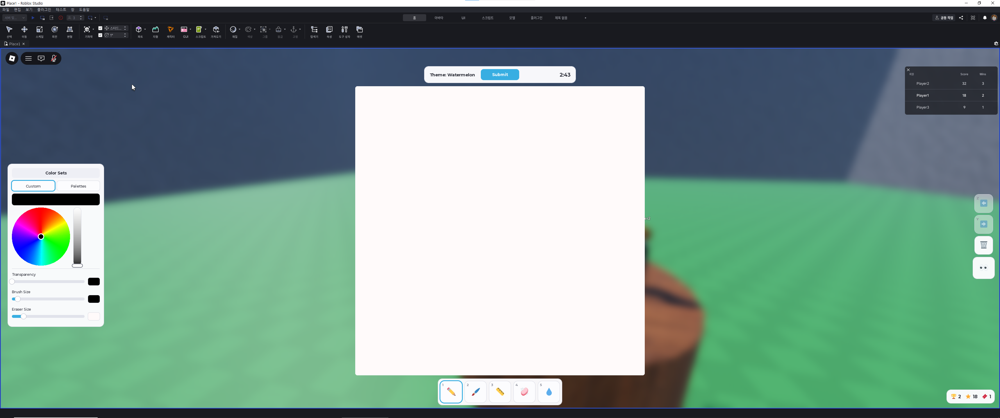
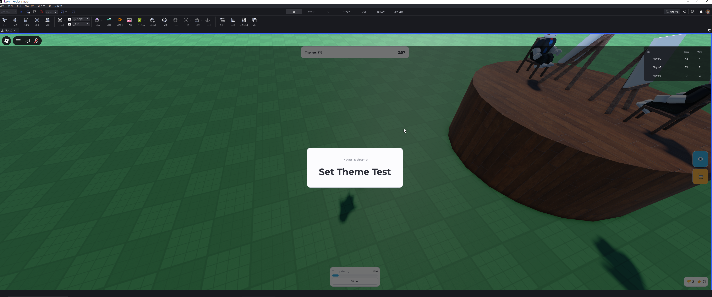

# Drawing Battle

**A Roblox competitive drawing game where the audience is the judge.**
Two players (or more) draw the same theme against time. Everyone else watches live and rates both drawings with 1–5 stars.

> The full design document is written in Korean and starts below this English overview.
> It is the project's single source of truth, and code comments point to its sections as `README §x.y`.


*Drawing screen: canvas, color panel and tool bar (Roblox Studio test, October 2026)*

| | |
|---|---|
| **Genre** | Party / drawing game |
| **Platform** | Roblox (PC, mobile, tablet) |
| **Period** | August 2026 – present |
| **Status** | Pre-launch. Public release planned for early November 2026 |
| **Team** | One developer, building with Claude Code (AI) |
| **Tech** | Luau (`--!strict`), Rojo 7.7, Git · Roblox EditableImage, DataStoreService, MarketplaceService, TextService |

## Who did what

- **Me**: game design and every rule, prices of the Robux items, all play-testing (PC, mobile, tablet), finding bugs and guessing their causes, building the map and drawing seats in Roblox Studio, Creator Dashboard setup (developer products, API access), commits and devlogs.
- **Claude Code (AI)**: wrote almost all of the code, following my decisions, and explained every change (why this way, what the alternatives were, and why not) so that I can learn the code and explain it myself.

The design document below records each decision and who made it.

## How a round works

1. **Pick**: two players are picked at random. The longer you wait, the more likely you are to be picked
2. **Theme**: both get the same theme, from a word list or one that a player set with a ticket
3. **Draw**: each player draws on their own canvas before the timer runs out. Spectators watch both live
4. **Rate**: spectators give each drawing 1–5 stars
5. **Result**: more stars wins. Wins and score are saved to the leaderboard

## Key features

- **Drawing canvas**: a stroke-based canvas on `EditableImage` with pen, brush, line, eraser, eyedropper, undo/redo and a color wheel. Strokes stream to spectators in real time.
- **Audience judging**: the server checks every rating (only spectators, only this round's drawers, 1–5 whole stars) and keeps wins and score in DataStore.
- **Fair turns**: weighted random picking with a visible *Turn priority* gauge, no back-to-back turns when there are enough players, and a *Sit out* button.
- **Robux items** (developer products): *Peek* at the opponent's drawing while drawing, a *Write a Theme* ticket (also free for every 21 minutes of play, and they stack), and *Draw next round*. Each purchase is granted once, even if Roblox retries the receipt.
- **Every screen size**: all UI is built in code and scales from phones to monitors. Custom loading screen, and tips while waiting.


*A theme chosen by a player is revealed at the start of the round (Roblox Studio test, October 2026)*

## Technical challenges

### 1. Hiding is not the same as not sending
- **Problem**: at first the server sent every stroke to every player, and the screen simply *hid* the opponent's drawing. Peek "un-hid" it. But anything sent to a player's computer can be read with an exploit, so a cheater could peek for free.
- **Fix**: the server decides who may see a drawing (`canSee` in `RoundService.server.lua`) and **does not send** strokes to anyone who isn't allowed. The same rule guards the "send me the whole canvas" request.
- **Follow-up**: buying Peek in the middle of a round must also show everything drawn so far, so the server sends the whole canvas first and live strokes after that. The screen deliberately does not re-check "did I buy it?", because the canvas arrives before the "unlocked" message and would be thrown away.

### 2. A bug that is only sometimes right (found in my multiplayer test)
- **Problem**: when two players bought *Draw next round*, only the first buyer's gauge filled to 100%. The second buyer still got to draw. Only the screen was wrong.
- **Cause**: the gauge was part of the round state, which the server only sent when the round phase changed. Purchases can happen at any time. The first buyer looked correct only because something else happened to trigger a send.
- **Fix**: the server re-sends the round state whenever a booking changes (it watches the player's `DrawNextBooked` attribute), so it no longer depends on luck.

### 3. Waiting in the middle of a check (found in a code review I asked for)
- **Problem**: two players could submit a theme at almost the same moment. Both passed the "is the slot free?" check, both lost a ticket, and the later one overwrote the first. Purchase receipts had the same shape and could grant an item twice.
- **Cause**: between the check and the change, the server waits for Roblox's text filter (`FilterStringAsync`). While it waits, other requests run.
- **Fix**: claim the slot *before* waiting, check again *after* waiting, and release the claim on every exit path.

## Running it

Requires Roblox Studio with the [Rojo](https://rojo.space) plugin.

```bash
rokit install   # installs Rojo 7.7.0, pinned in rokit.toml
rojo serve      # then press Connect in the Rojo plugin in Roblox Studio
```

Saving uses DataStores, so turn on *Studio access to API services* in the game settings to test it in Studio.

## Where to look

| | |
|---|---|
| `src/ReplicatedFirst/` | Loading screen. Runs before the rest of the game arrives |
| `src/Shared/Config.lua` | Every tunable value in one place (times, prices, colors, tips) |
| `src/Shared/DrawingCanvas.lua` | Canvas core: tools, undo/redo, stroke data |
| `src/Server/RoundService.server.lua` | The round loop, and who may see whose drawing (`canSee`) |
| `src/Server/DrawerPicker.lua` | Weighted random picking of drawers |
| `src/Server/PlayerStats.lua` | Leaderboard and saving (counters that only go up, merged with `UpdateAsync`) |
| `src/Server/PurchaseService.lua` | Robux receipts, granted exactly once |
| `src/Client/UI/` | Every screen element, built in code |

Code comments are in Korean. I am learning from them. The full folder tree is in §6.1 below.

## Devlog

- [Devlog #1 — 2026-10-25](devlog/2026-10-25.md) (Korean)

---

# DrawBattle 설계 문서 (한국어)

로블록스 1대1 그림 대결 게임. 관전자가 별점으로 심사한다.

> **AI 에이전트에게**: 이 문서는 프로젝트의 단일 진실 공급원이다.
> 작업 전에 반드시 전체를 읽을 것. "미정" 표시된 항목은 임의로 결정하지 말고
> 개발자에게 물어볼 것. "확정" 항목은 마음대로 바꾸지 말 것.

---

## 1. 게임 개요

로블록스 게임 *Draw It Better* 에서 영감을 받았으나, **판정 주체가 다르다.**
원본은 AI가 채점하지만 이 게임은 **관전자가 별점으로 심사한다.**

### 라운드 흐름

```
1. 선정    서버 인원 중 랜덤 2명. 안 뽑힐수록 확률 상승 (가중치 방식)
2. 주제    두 사람에게 동일한 주제 제시
3. 그리기  제한 시간 내 각자 그림
           - 서로의 그림은 기본적으로 안 보임
           - Robux 캐시템으로 엿보기 가능
           - 관전자는 양쪽 다 실시간으로 볼 수 있음
4. 심사    관전자가 각 그림에 별점 1~5개
5. 정산    별점 합산 높은 쪽이 승자
           승자 = 별점 합산 + 5
           패자 = 별점 합산
6. 다음 라운드
```

---

## 2. 설계 결정 사항

### 확정

| 항목 | 결정 | 비고 |
|---|---|---|
| 플랫폼 | 로블록스 | 관전자 확보가 쉬움 |
| 판정 방식 | 관전자 별점 (1~5) | 투표 기능은 **삭제됨** |
| 라운드 승패 | 별점 **합산** | 같은 서버·같은 관전자라 조건 동일 |
| 리더보드 | 로블록스 기본 `leaderstats` 의 **Wins / Score** | 재접속해도 이어짐 |
| Score | 라운드 점수(별점 합산 + 승자 보너스)의 **누적** | 눈에 보이는 성장치 |
| 프로 서버 자격 | 누적 **Score** 가 기준치 이상 | 기준 점수는 아직 미정 |
| 그림판 형태 | 화면 전체를 덮는 UI | 3D 월드 오브젝트 아님 |
| 좌우 분할 | 화살표 버튼으로 상대 그림 숨김/표시 토글 | |
| 프로 서버 | 별점 미달자도 **입장 가능**, 단 **그리기 불가** | |
| 베팅 | **넣지 않음** | 로블록스 도박 정책 위반 |
| 데이터 구조 | 픽셀이 아닌 **스트로크** 저장 | 이유는 §5 참고 |
| 서버 종류 | **3분 / 5분 / 프로(5분 고정)** 셋으로 나눔 | `Config.SERVER_MODES` |
| 최소 인원 | **3명** (그리는 2 + 관전 1) | 미달이면 라운드 시작 안 함 |
| 인터미션 | **15초** | |
| 제출 버튼 | 둘 다 누르면 시간이 남아도 라운드 종료 | **취소 불가** |
| 심사 시간 | **20초** | |
| 결과 화면 | **7초** | 심사와 인터미션 사이 |
| 별점 동점 | **무승부** | 보너스는 아무도 못 받음 |

### 캐시템 (Robux) — 확정

| 아이템 | 가격 | 내용 |
|---|---|---|
| 상대 그림 엿보기 | 10 R$ | **라운드가 끝날 때까지** 보인다. 보는 동안 **내 타이머는 계속 간다** |
| (가격 표시) | — | 버튼에 찍는 가격은 `GetProductInfo` 로 **대시보드에서 직접 읽는다.** `Config.PRODUCT_PRICES` 는 못 읽었을 때 쓰는 예비값일 뿐이다 |
| 주제 단어 직접 입력 | 30 R$ | 다음 라운드 주제를 내가 정한다. `FilterStringAsync` 필수 (§3.1) |
| 다음 라운드에 내가 그리기 | 15 R$ | **라운드당 2명까지** (§3.2). 두 명이 사면 품절 |

**엿보기를 "라운드 끝까지" 로 정한 것은 §3.3 에서 베끼기 위험이 가장 큰 쪽이다.**
결정 사항이지만, 실제로 베끼는 사람이 나오면 `Config.PEEK_LASTS_ALL_ROUND` 를
끄고 초 단위로 바꾼다. 그때를 위해 지켜볼 것.

**게임에서 21분을 놀 때마다 주제 작성권을 하나 공짜로 준다. 쌓인다.** (확정, 2026-10-28 개정)
로벅스로 사는 것과 같은 물건이고, 개수는 화면 오른쪽 아래 🎟️ 칸에 뜬다.
**하나도 없으면 그 칸은 아예 안 보인다.**

- **유저에게도 21분이라고 말한다.** (2026-10-28 개발자 결정) 기다리는 동안 뜨는 팁이
  `Config.PLAY_SECONDS_PER_TOKEN` 에서 숫자를 그대로 만들어 쓴다
  - ⚠️ 예전에는 "실제 21분, 유저에게는 20분" 이었고 이유는 "넉넉한 쪽으로 둔다" 였다.
    그런데 20분이라 말하고 21분에 주면 **말보다 늦게** 준다. 이유와 정반대였다.
    화면 어디에도 시간이 안 나와서 아무도 몰랐고, 팁에 시간을 쓰려다 드러났다 (AI 가 작업 중 발견)
- **대기 중인 시간도 센다.** 접속해 있으면 그냥 오른다
- **쌓인다. 상한 없음.** (2026-10-28 개발자 결정, `Config.MAX_FREE_TOKENS = math.huge`)
  한 장 받은 뒤에도 다음 21분을 또 세서 또 준다. 예전 규칙은 "한 장까지만" 이었다.
  다시 상한을 두고 싶으면 그 숫자만 바꾸면 된다
  - 상한에 닿으면 **"다음 장" 시계만** 멈추고 총 플레이 시간은 계속 센다
  - 지켜볼 것: 오래 노는 사람이 수십 장을 모으면 유료 작성권(30 R$)이 덜 팔린다. 그게 보이면 상한을 건다
  - ⚠️ **대기 중 시간도 세기 때문에, 상한이 없으면 빈 서버에 켜두고 방치해서 계속 모을 수 있다.**
    예전에는 "한 장까지만" 이 바로 이걸 막아줬다 (그래서 대기 중 시간을 세도 괜찮았다).
    모은 사람이 매 판 주제 자리(라운드당 하나, 먼저 넣는 사람 것)를 차지하면 돈 낸 사람이 못 넣는다.
    상한을 둘지는 개발자가 정한다 (AI 가 작업 중 발견, 2026-10-28)
- **무료와 유료는 지갑이 다르다.** 상한을 걸 수 있는 건 무료뿐이고, **로벅스로 산 것은 늘 쌓인다.**
  한 통으로 세면 상한을 걸었을 때 유료로 한 장 산 사람이 그동안 무료를 못 받게 된다.
  쓸 때는 **무료부터** 쓴다
- 접속을 끊어도 **유지된다.** 19분에 끊겼다고 0 이 되면
  인터넷이 불안정한 사람만 손해를 본다
- 완전히 방치하면 로블록스가 20분 만에 내보낸다(자리 비움 퇴장). 다만 시간은 저장되므로
  다시 들어오면 이어서 센다. 방치를 막아주는 장치는 아니다
- **`playSeconds` 는 이제 진짜 총 플레이 시간이다** (화면 ⏱️ 칸은 이걸 안 쓴다 — 그건 이번 접속 시간이다). 예전에는 한 장 들고 있는 동안
  "다음 장을 안 센다" 를 **시계를 멈추는 방법**으로 해서 총 시간까지 같이 멈췄다.
  한 숫자에 두 가지 일을 맡긴 탓이다. 이제 총 시간은 늘 세고 "다음 장" 시계(`playSeconds − tokenClockBase`)만 따로 붙잡는다.
  그래서 예전부터 하던 계정은 그동안 멈춘 만큼 총 시간이 적게 나온다 (출시 전이라 테스트 계정뿐)
- 저장은 **전부 늘기만 하는 값**으로 둔다. 남은 개수 = 받은 것 + 산 것 − 쓴 것.
  남은 개수를 그대로 저장하면 줄어드는 값이 되어 delta 저장과 안 맞는다 (§3.11-2)
- 다음 장까지의 시간은 **`tokenClockBase`(이번 판을 언제부터 셌나)** 로 잰다.
  `(받은 장수 + 1) × 기준시간` 으로 재면 안 된다 — 15초마다 세느라 매번 조금씩
  넘겨서 받고, 기준시간을 바꾸거나 옛 데이터가 있으면 크게 벌어진다.
  실제로 **쓰자마자 다시 지급되는** 일이 있었다
- 저장소에서 **아직 못 읽어온 동안에는 시간을 안 센다.** 그때 session 은 전부 0 이라
  "15초 놀았다" 를 기준으로 지급 여부를 따지게 된다

**못 받으면 저장해둔다.** 주제 단어와 "다음에 내가 그리기" 는 다음 라운드에
쓰는 물건이라, 그 사이에 서버가 닫히거나 게임을 끄면 못 받게 된다.
그래서 저장해뒀다가 **다음 접속에 적용한다.** 로벅스를 받고 못 준 상태를 만들지 않는다.

### 상점 — 확정

화면 오른쪽 세로줄의 🛒 를 누르면 가운데에 열린다.

| 칸 | 내용 |
|---|---|
| 주제 쓰는 칸 | 작성권이 있어야 글자를 칠 수 있다. 없으면 칸이 잠긴다 |
| Theme ticket | 30 R$. 사면 작성권 한 장 (쌓인다) |
| Draw next round | 15 R$. 다음 라운드에 무조건 그린다 (라운드당 2명까지) |

**그리는 동안에는 안 열린다.** 여기서 파는 것은 전부 다음 라운드 물건이고,
그리는 중에 창을 띄우면 그 사이에 시간만 간다.

**엿보기는 상점에 없다.** 그리는 도중에만 쓰는 물건이라 캔버스 옆 👀 버튼으로 뺐다.
관전자용 눈 버튼(👁)과 아이콘을 달리 뒀다 — 하나는 공짜로 목록을 여닫고
하나는 로벅스를 낸다. 같은 그림이면 그리는 사람이 헷갈려서 누른다.

**엿보기 화면은 "전환 버튼" 방식이다.** (확정, 2026-10-26)
산 뒤에 👀 를 누르면 내 그림판 자리에 상대 그림이 뜨고, 다시 누르면 내 그림으로 돌아온다.
라운드 끝까지 몇 번이든 바꿀 수 있다. **보는 동안에는 못 그리고, 타이머는 계속 간다.**
그게 엿보기의 대가다 — 베끼려면 시간을 써야 한다 (§3.3).
옆에 작은 창을 계속 띄우는 방식도 있었지만, 그러면 그림판이 작아지고(특히 모바일)
나란히 놓고 베끼기가 가장 쉬워져서 고르지 않았다.

- 종이를 **두 장** 겹쳐 두고 보이는 쪽만 바꾼다. 한 장으로 바꿔 그리면 바꿀 때마다
  종이를 비워야 하는데, 비우는 순간 **내 그림과 되돌리기 기록이 날아간다**
- 상대 그림을 보는 동안에는 **그림판 도구(펜·색·되돌리기 줄)를 통째로 숨긴다.** (확정 2026-10-27)
  단축키(Z, Y, 도구 1~5)도 자기 줄이 숨겨져 있으면 무시하므로 같이 잠긴다.
  처음에는 도구를 띄워둔 채 되돌리기만 막았는데, 눌러도 안 되는 버튼이 잔뜩 떠 있는 셈이었다.
  되돌리기 쪽 잠금은 2차로 남겨뒀다. 안 막으면 **안 보이는 내 그림**이 지워진다
- 숨긴 도구는 **자리를 그대로 맡아둔다.** 안 그러면 👀 를 누를 때마다 도구가 비킨 만큼
  캔버스가 커졌다 작아졌다 해서, 두 그림을 번갈아 보며 비교하는 기능이 비교가 안 된다.
  오른쪽 세로줄도 같다. 엿보는 동안에는 줄이 텅 비지만 그 자리를 맡아둔다
- 👀 버튼과 위쪽 Submit 은 남긴다. 👀 는 내 그림으로 돌아오는 유일한 길이다
- **제출한 뒤에도 👀 는 남는다.** (확정 2026-10-27 개발자 결정) 사기도, 바꿔 보기도 된다.
  다른 도구는 제출하면 원래대로 사라진다. 제출하고 남은 시간이 "상대는 뭘 그렸나" 가 제일 궁금한 때이고,
  이미 제출했으니 베낄 수도 없다. 서버는 원래부터 "제출했는가" 를 안 봐서(`applyPeek`, `canSee`)
  화면 쪽 조건(`canPeek` = 이번 판의 그리는 사람)만 바꿨다.
  제출 뒤에는 도구가 원래 없으므로, 엿볼 때 도구 자리를 맡아두지 않는다(맡으면 그림판이 줄어든다)
- **👀 버튼은 그림판 오른쪽 위 모서리 바로 바깥에 붙어 있다.** (확정 2026-10-27 개발자 요청)
  예전에는 오른쪽 세로줄 맨 아래에 있어서 넓은 화면에서는 그림판과 멀리 떨어져 잘 안 보였다.
  아이콘 아래에 **누르면 하는 일**을 글자로 적는다 — `Peek`(상대 그림 보기) / `Back`(내 그림으로)
  - 왜 "오른쪽 위" 인가: 오른쪽 가운데는 태블릿(1024x768)에서 세로줄과 겹치고(틈이 33px),
    상단 바는 폭이 고정이라 자리가 없고, 아래는 펜 줄이 있고, 그림판 안은 그림을 가린다.
    오른쪽 위는 세로줄(화면 세로 가운데)보다 위쪽이라 폭이 모자란 화면에서도 비켜 간다
  - 그림판 칸(`CanvasArea`)의 자식이라, 그림판이 움직이고 커질 때 **저절로 따라온다.**
    밖에 두고 따로 옮기면 트윈을 두 번 걸어야 하고, 둘이 어긋나는 순간 버튼이 그림 위에 올라탄다
  - 그래서 세로줄 안에서 👀 를 제자리에 두던 빈칸(PeekSpacer, 2026-10-27)은 지웠다.
    👀 가 그 줄을 떠나면서 할 일이 없어졌다
- **엿보기는 그 라운드 한 판짜리다.** 게임패스(한 번 사면 영구)가 아니라 개발자 상품이라
  판마다 다시 산다. 라운드가 바뀌면 `state.peeking` 을 비운다
- 화면은 "샀는가" 를 보지 않고, **상대 그림이 오면 그냥 보여준다.**
  서버가 산 사람에게만 보내니(canSee) 온 것 자체가 볼 자격이다.
  "샀는가" 를 보고 거르면, 서버가 그림을 먼저 보내고 "열렸다" 를 나중에 보내서
  지금까지 그린 그림이 통째로 버려진다

**⚠️ 2026-10-26 까지 엿보기는 돈만 받고 아무것도 안 보여주는 상태였다.**
서버는 지급하고 상대 그림도 보냈지만, 화면이 "관전 중인 사람" 의 그림만 그려서
그리는 사람에게 온 상대 그림을 버렸다. 상품 ID 를 넣기 전에 찾았다.
서버에서 "지급했다" 까지만 확인하고 끝난 줄 안 것이 원인이다.
**기능은 버튼 → 결제 → 지급 → 화면까지 끝에서 끝까지 따라가 봐야 완성인지 안다.**

**"다음 판 그리기" 버튼은 상태가 셋이다.** 라운드당 정원(`DRAW_NEXT_SEATS`, 지금 2명)이 있어서 (§3.2)

| 상태 | 버튼 |
|---|---|
| 살 수 있음 | `Draw next round R$15` |
| 내가 사뒀음 | `Booked for next round` (꺼짐) |
| 남들이 정원(2명)을 채움 | `Draw next round — sold out` (꺼짐) |

- 살 수 없을 때 버튼을 꺼야 한다. 켜두면 이미 산 사람이 또 사거나 품절인데 사버린다.
  받은 돈은 돌려줄 수 없으니 서버는 그다음 판으로 미루는데, "다음 판" 이라고 알고 산
  사람에게는 약속을 어긴 게 된다
- 그래도 정원이 찬 순간에 누가 거의 동시에 사면 결제가 될 수 있다. 로블록스 결제는
  서버가 중간에 끊을 수 없기 때문이다. 그때 넘친 사람은 그다음 판에 그린다.
  미뤄진 사람에게도 "품절" 이 아니라 "예약됨" 으로 보인다
- **사면 게이지가 100% 가 된다.** (확정 2026-10-27 개발자 결정)
  나갔다 들어와도 100% 그대로다(예약은 DataStore 에 남는다).
  실제로 그리고 나면 예약이 차감되어 0% 로 돌아간다
  - ⚠️ 겉으로는 "게이지 100%" 지만 속은 **자리 확정**이다. 게이지가 꽉 찬 사람이 여럿이면
    그중에서 또 뽑기를 하므로, 진짜로 가중치만 올려주면 **돈을 내고도 떨어질 수 있다**
  - **예약이 있는 동안은 Sit out 을 못 누른다.** 버튼이 `Booked for next round` 로 바뀌고 흐려진다.
    서버도 같은 요청을 거절한다(화면 잠금은 우회될 수 있다, §3.4).
    쉬는 중에 사면 **쉬기가 풀린다** — 산 것 자체가 "그리겠다" 는 뜻이다.
    (구매 버튼을 쉬는 동안 막는 방법은 고르지 않았다. 로벅스 결제는 서버가 중간에 못 끊어서,
    화면에서 막아도 결제가 되어버리는 틈이 남는다)
  - 쉬는 중의 "Join back" 은 언제나 된다. 잠그는 것은 쉬러 가는 쪽뿐이다
  - **100% 가 정원(2명)보다 많으면 그 안에서 무작위로 뽑는다.** (확정 2026-10-27 개발자 결정)
    한 서버 안에서는 품절 때문에 못 넘지만, 다른 서버에서 산 예약을 들고 들어오면 넘을 수 있다.
    들어온 순서로 자르면 늘 먼저 온 사람이 이기고, 가중치로 뽑으면 똑같이 100% 인데
    누구는 더 잘 뽑힌다. 화면에 셋 다 100% 로 보이니 **같은 확률**이 화면과 맞다.
    떨어진 사람의 예약은 안 쓰였으므로 남아서 다음 판에 또 다툰다
- **사는 순간 전원 화면을 다시 보낸다.** 2026-10-27 테스트에서 두 번째로 산 사람의 게이지가
  100% 로 안 찼다. 서버는 예약을 제대로 받아 다음 판에 앉혔는데 **화면만 옛날 것**이었다.
  게이지·품절 정보는 단계가 바뀔 때만 나가고 있었다. 첫 번째 사람이 멀쩡해 보인 건
  마침 다른 일로 화면이 다시 나갔기 때문으로 보인다 — **가끔 맞는 버그가 제일 늦게 잡힌다**
- 사면 `You'll draw next round!` 알림이 뜨고, 엿보기가 열리면
  `Peek unlocked! Press 👀 to switch views.` 가 뜬다. 사고 나서 아무 반응이 없으면
  결제가 된 건지 알 수 없다

**주제 글자는 클라이언트에 안 보낸다.** "누가 정했다" 는 사실만 보낸다.
미리 알면 혼자 연습하고 들어올 수 있다. (§3.1)

**정해둔 주제로 라운드가 시작되면 뽑기를 돌리지 않는다.** (확정)
대신 화면 가운데에 **"MrKim's theme / Apple"** 을 3초 보여준다(`PROMPT_CHOSEN_SECONDS`).
정해진 답을 놓고 뽑기 기계를 돌리면 연기다. 다들 알림으로 미리 들었다.
정한 사람의 이름은 **주제를 넣는 순간** 적어둔다. 라운드 시작 전에 나가도 이름은 남는다.

**라운드 도중에도 넣을 수 있다.** 언제 넣든 **다음 라운드** 주제다. (확정)
예전에는 그리는 중이면 거절했는데, 그럴 이유가 없었다.

**작성권은 주제를 넣는 순간 깎는다.** (확정)
처음에는 그 주제로 라운드가 실제로 시작될 때 깎았다. 서버가 그 사이에 닫혀도
티켓이 안 없어지는 장점이 있었지만, 화면에서는 주제를 넣었는데 티켓이 그대로라
**안 쓴 것처럼 보였다.** 눈에 보이는 쪽을 택했다.

대신 두 가지를 지킨다.
- 걸러져서 **거절당한 낱말에는 티켓을 안 물린다.** 검사가 전부 끝난 뒤에 깎는다
- **한 번 정하면 못 고친다.** 본인이 정한 것도 마찬가지다.
  라운드당 자리가 하나이고 그 자리는 한 번만 팔린다.
  고칠 수 있게 두면 "티켓 없이 몇 번이고 바꾸는" 길이 생기고,
  그 길마다 규칙을 또 세워야 한다. 한 번으로 끝내면 설명할 것이 한 줄이다.
  화면도 똑같이 잠근다 — 화면만 열어두면 눌렀다가 거절당하고 이유를 알 수 없다
- 알림은 라운드당 한 번뿐이라 도배될 수가 없다
- 글자 수는 `utf8.len` 으로 센다. **`#` 은 바이트를 센다** —
  그대로 두면 24자 제한이 한글 8자가 된다

### 알림 (Toast) — 확정

화면 위쪽 가운데에 짧게 떴다 사라진다. 게임의 **유일한** 알림 장치다 (작성권 받음, 캐시템 구매, 다음 주제 정해짐, 스포이드 등).
21분은 긴 시간이라, 받은 줄 모르고 지나가면 그동안 기다린 것이 없던 일이 된다.
오른쪽 아래 🎟️ 숫자가 0에서 1로 바뀌는 것만으로는 아무도 못 알아챈다.

### 흐린 팁 / 플레이 시간 / 1인칭 막기 — 확정 (2026-10-28 개발자 결정)

**흐린 팁** (`UI/TipLine.lua`, 문구는 `Config.TIPS`)
- 상단 바 바로 아래에 흐리게 보인다. 보이는 때 (같은 날 한 번 고침):
  - **대기·인터미션** — 모두에게
  - **그리기 단계** — 그리지 않는 사람에게만. 단 관전 화면(그림판)을 열면 숨는다.
    이 조건은 개발자가 말한 것이 아니라 **겹침 때문에** 붙였다 — 팁 자리와 그림판 윗부분이 같은 곳이다
  - **심사·결과** — 아무에게도 안 보인다 (처음엔 결과 때도 보였다)
- 7초마다 다음 팁으로 바뀐다. 첫 팁은 사람마다 무작위다 — 다들 첫 팁부터 보면 뒤쪽 팁은 아무도 못 본다
- 숫자가 들어가는 팁은 **설정값에서 만든다.** 손으로 적으면 나중에 값을 바꿨을 때 팁만 옛 숫자로 남는다
- 맵 위에 바로 떠 있어서 배경이 밝을 수도 어두울 수도 있다. 글자에 옅은 흰 테두리를 둘렀다
- 프로 서버 팁은 아직 없다. 프로 서버와 기준 점수 N 이 생기면(6단계) 넣는다

**⏱️ 이번 접속 시간** — 오른쪽 아래 점수 줄 끝, `45m` / `3h 12m`. **이 서버에 들어온 뒤 지난 시간**이다.
- 처음에는 저장된 "총 플레이 시간" 을 보여줬다. 테스트 창 4개를 띄우니 누구는 1분, 누구는 23분이었다
  (가상 플레이어마다 예전 테스트 기록이 달랐다). 같은 순간에 들어온 사람들이 다른 숫자를 보면 고장으로 읽힌다.
  그래서 기준을 바꿨다 (개발자 테스트로 발견, 2026-10-28 개발자 결정)
- 저장소를 안 쓰고 **화면이 스스로 센다** (접속 직후부터). 서버에 물어볼 것이 없어서 통로도 특성도 필요 없다
- 초는 안 보여준다. 구석에서 숫자가 1초마다 움직이면 자꾸 눈이 간다

**1인칭 막기** — `StarterPlayer.CameraMinZoomDistance = 8` (`default.project.json`).
그리거나 UI 를 보다가 스크롤하면 카메라가 머리 속까지 들어가 1인칭이 됐다. 마우스가 화면 가운데에 묶여서
빠져나오려면 O 키(또는 휠)로 다시 멀어져야 하는데, 그걸 아는 사람이 적다 (개발자 테스트로 발견).
로블록스 기본 최소 거리는 0.5 라 거의 머리 속이다. 8 이면 스크롤해도 그 거리에서 멈춘다

### 안 그리기 (무료) — 확정

"이번엔 관전만 하겠다" 를 선언하는 버튼. 뽑기에서 빠진다.

- **가중치는 계속 오른다.** 쉬었다고 줄 맨 뒤로 밀리면 아무도 안 누른다
- **게이지도 그대로 보인다.** 쉬는 동안 0% 로 비워버리면 그동안 쌓인 것이
  사라진 것처럼 보인다. 실제로는 계속 오르고 있으므로
  **"지금 돌아오면 얼마인가"** 를 보여준다. 쉬는 중이라는 것은 제목 줄과
  막대 색(흐린 회색)으로 알린다
- 그리는 도중에는 못 바꾼다. 눌러도 이번 판이 취소되지 않으므로 버튼이 거짓말이 된다
- **"다음 판 그리기" 예약이 있으면 못 누른다** (`Booked for next round`). 쉬는 중에 사면 쉬기가 풀린다 (2026-10-27)
- 선언이 많아 그릴 사람이 2명이 안 되면 **라운드를 시작하지 않고 기다린다.**
  선언을 무시하고 뽑으면 그것도 버튼이 거짓말을 하는 것이다.
  화면에는 "Waiting for someone to draw" 를 띄워 이유를 밝힌다

### 연달아 그리지 않기 — 확정

**직전 라운드에 그린 사람은 다음 뽑기 후보에서 뺀다.**
그래서 그리고 나면 게이지가 진짜로 **0%** 가 된다.

가중치만으로는 이걸 못 막는다. 뽑힌 사람이 1 로 돌아갈 뿐 0 이 되지는 않아서,
3명·2자리면 방금 그린 사람이 다음 판에도 58% 로 뽑힌다.

| 서버 인원 | 규칙 전 | 규칙 후 |
|---|---|---|
| 3명 | 58% | 58% — 둘을 빼면 1명만 남아 라운드가 안 열린다. 그대로 둔다 |
| 4명 | 37% | **0%** |
| 6명 | 21% | **0%** |

**예외 두 가지**
- 빼고 나서 자리를 채울 만큼 안 남으면 도로 넣는다.
  3명뿐인 서버에서 라운드가 영영 안 열리는 것보다 연달아 그리는 편이 낫다
- **돈을 낸 사람은 이긴다.** "다음 라운드에 내가 그리기"(15 R$)를 산 사람은
  방금 그렸어도 다음 판에 그린다. "다음 라운드" 라고 하고 팔았기 때문이다

화면에 보이는 확률과 실제 뽑기가 **같은 함수**(`pickPool`)를 쓴다.
두 곳에 따로 적으면 반드시 어긋난다. (§5.5-3)

### 그릴 차례 게이지 — 확정

화면 **가운데 아래**. 이름은 **`Turn priority`**.
막대와 숫자는 **같은 값**이다 — 가중치 진행도 (1→8 을 0→100% 로 편 값).

**확률이 아니다. 일부러 확률을 안 쓴다.** (확정)
확률은 몇 명이 다투느냐에 달려 있다. 3명 서버에 막 들어오면 자리가 2개라 67%,
10명 서버면 같은 사람이 20% 로 시작한다. 아무것도 안 했는데 누가 들어오면
숫자가 떨어지기도 한다. 그러면 이 값이 "내가 얼마나 기다렸나" 가 아니라
**"지금 서버가 얼마나 붐비나"** 를 재게 된다.

진행도는 인원과 상관없다. **새로 들어오면 0%, 판마다 오르고, 그리면 다시 0%.**

이름이 `Likely to draw` 가 아닌 이유: **100% 여도 반드시 그리는 것은 아니다.**
가중치 상한에 닿았다는 뜻이고, 남도 높으면 밀릴 수 있다.
확률처럼 읽히는 이름 옆에 확률 아닌 % 를 두면 §5.5-11 과 같은 실수가 된다.

⚠️ **예외: "다음 판 그리기" 를 사서 된 100% 는 확정이다.** (2026-10-27~)
같은 100% 가 두 가지 뜻을 갖게 됐다. 지금은 상점 버튼과 Sit out 자리의 `Booked for next round` 가 구분해준다.
헷갈린다는 반응이 나오면 산 사람의 게이지 제목을 따로(예: `Booked`) 바꾼다.

⬜ **막대가 잘 안 찬다.** 상한이 8이라 100% 가 되려면 7판을 내리 밀려야 하는데,
   8명 서버에서도 보통 4판쯤이면 뽑혀서 43% 근처가 최고다.
   `Config.PICK_MAX_WEIGHT` 를 낮추면 막대는 빨리 차지만, **오래 기다린 사람의 이점도 같이 줄어든다.**
   (상한 8이면 최대 8배, 4면 최대 4배.) 뽑기가 그냥 무작위에 가까워져서
   **오래 못 뽑히는 사람이 오히려 더 자주 나온다.** 막대 보기 좋자고 낮출 값이 아니다.
   예전에 여기 "낮추면 더 공평해진다" 고 적었는데 틀린 설명이었다. (2026-10-25 정정)

**자리는 가운데 아래다.** 왼쪽 아래는 모바일 이동 조종기, 오른쪽 아래는
점프 버튼과 승리수 줄이 쓴다. 관전 줄이 펼쳐지면 그 위로 올라간다.

**그리는 사람에게는 이번 라운드 동안 숨는다.** 이미 뽑힌 판에서 그릴 확률은
뜻이 없고, 그리는 옆에 버튼이 있으면 방해가 된다.
서버도 `isDrawer` 검사로 막으므로 화면만 끈 것이 아니다. (§3.4)

### 로딩 화면 — 확정 (2026-10-28)

| 항목 | 정한 것 (개발자 결정) |
|---|---|
| 제목 | `Drawing Battle` (대시보드에 등록된 게임 이름과 같게) |
| 배경 | 모눈종이 (흰 바탕 + 옅은 격자, 다섯 칸마다 조금 진한 선) |
| 넣은 것 | 진행 막대, 연필이 선을 긋는 애니메이션, Skip 버튼. 규칙 팁 문구는 안 넣었다 |
| 사라질 때 | 게임을 다 받고 내 캐릭터가 맵에 나타나면. 점수·티켓까지는 안 기다린다 |

만들면서 정한 것 (AI 판단, `src/ReplicatedFirst/LoadingScreen.client.lua`)
- **`ReplicatedFirst` 에서 돈다.** 게임을 받는 동안 가장 먼저 와서 바로 실행되는 유일한 곳이다.
  다른 곳에 만들면 **로딩이 끝난 다음에** 로딩 화면이 뜬다
- **Config 를 안 쓴다.** 이 스크립트가 도는 순간에는 Config 가 아직 안 왔을 수 있고, 기다리면 화면이 빈다.
  색은 Config.UI 와 같은 값을 따로 적었다. **게임 색을 바꾸면 여기도 같이 바꿀 것** (§5.5-3 을 알고 고른 예외)
- **최소 2초, 최대 20초.** 번쩍 사라지지 않게, 그리고 무엇이 안 끝나도 갇히지 않게
- **Skip 은 3초 뒤, 아래 가운데.** 처음엔 오른쪽 아래로 보여줬지만 그 자리는 모바일 점프 버튼이다.
  로블록스 버튼은 우리 화면보다 위에 그려져서 Skip 대신 점프가 눌린다
- **진행 막대는 단계마다 한 칸** (게임 받기 → 맵). 로블록스는 남은 양을 정확히 안 알려줘서,
  시간에 맞춰 부드럽게 채우면 다 찼는데 안 끝나는 **거짓말하는 막대**가 된다
- **연필 선은 필기체처럼 고리가 생기고, 한 줄마다 색이 바뀐다** (파랑 → 보라 → 주황, 게임 버튼 세 색)
- **연필 이모지(✏️)는 90도 돌려 쓴다.** 로블록스 글꼴에서는 심이 오른쪽 아래를 향한다.
  처음에 왼쪽 아래라고 짐작해서 심이 선보다 앞에 나가 있었다 (2026-10-28 개발자 테스트로 발견).
  이모지는 글꼴마다 그림이 달라서 짐작하지 말고 눈으로 확인할 것
- **사라질 때는 종이가 위로 걷힌다.** 격자 선 80개를 하나하나 흐리게 하는 것보다 간단하다
- **스튜디오 미리보기 시간** (`STUDIO_PREVIEW_SECONDS`). 디자인을 볼 때만 8초쯤으로 올린다.
  게시한 게임에는 `RunService:IsStudio()` 로 막혀서 **절대 적용되지 않는다.** 2026-10-28 디자인 확인이 끝나 0 으로 돌렸다
- `ResetOnSpawn = false` 가 필수다. 켜져 있으면 캐릭터가 나타나는 순간(= 이 화면이 기다리는 신호) 로블록스가 화면을 지운다

### 등급 기준 — 잠정 (출시 후 데이터 보고 조정)

```lua
PRO_SERVER_MIN_RATING   = 3.5   -- 입장(그리기) 기준: 최근 20판 평균
PRO_SERVER_DEMOTE_RATING = 3.2  -- 강등 기준 (히스테리시스)
PRO_SERVER_MIN_ROUNDS   = 20    -- 최소 판수
RATING_WINDOW           = 20    -- 평균 낼 판 수
```

입장선과 강등선을 벌려둔 이유: 같은 값이면 경계에서 승격/강등이 무한 반복된다.

**프로 서버 자격은 누적 `Score` 로 건다.** (결정됨)
리더보드에 보이는 그 숫자를 그대로 쓴다. 플레이어가 자기 진행도를 눈으로 보고
"얼마나 더 하면 되는지" 알 수 있는 것이 평균보다 낫다고 판단했다.
위의 `PRO_SERVER_MIN_RATING` 같은 평균 기준값은 **쓰지 않는다.**

기준 점수(N점)는 아직 안 정했다. 실제 판이 돌아서 한 판에 몇 점씩 들어오는지
보고 나서 정한다. 지금 숫자를 찍으면 근거가 없다.

평균(`PlayerStats.GetAverage()`)은 코드에 남아 있지만 **어디에도 안 쓴다.**
지우지 않은 이유는 지우는 데 이득이 없어서다. 화면에도 안 나오고 비용도 없다.

### 미정 — 결정 전까지 구현 금지

- [x] ~~그리기 제한 시간~~ → 서버별로 다름. 3분 / 5분 / 프로 5분 고정
- [x] ~~주제 선정 방식~~ → **고정 딕셔너리**. AI 생성은 쓰지 않는다
- [x] ~~관전자 0명일 때 라운드 처리~~ → **3명 미만이면 라운드를 시작하지 않고 대기**
- [x] ~~별점 동점 시 처리~~ → **무승부**. 둘 다 합산만 받고 보너스는 아무도 못 받는다
- [x] ~~심사 시간~~ → **20초**
- [x] ~~프로 서버 자격 기준~~ → **누적 `Score`**. 리더보드에 보이는 숫자를 그대로 쓴다
- [ ] 프로 서버 자격 기준 **점수(N)** — 6단계에서. 실제 판이 돌아 점수 분포를 보고 정한다
- [x] ~~캐시템 각각의 Robux 가격~~ → 엿보기 **10** / 주제 작성권 **30** / 다음 판 그리기 **15**
- [x] ~~엿보기 지속 시간 / 내 타이머가 멈추는지 여부~~ → **라운드 끝까지**, 타이머는 **계속 간다**
- [ ] 신고 기능 구현 방식
- [ ] 피드백 버튼 — 출시 직전에 만든다 (2026-10-28 개발자 결정). 무엇을 받을지(글? 별점?)는 그때 정한다
- [ ] 맵 디자인 (코드가 아닌 스튜디오에서 수작업 예정)
      의자는 **코드가 실행 중에 찾는다.** 좌표를 적어두지 않으므로
      의자를 옮기거나 새로 놓아도 코드는 안 고쳐도 된다. §5.4 참고

### 논의됐으나 반려 / 보류

- **투표 기능** — 별점과 중복이라 삭제
- **베팅** — 정책 위반 + 투표 조작 유인

---

## 3. 알려진 위험 요소

작업 시 반드시 인지할 것.

### 3.1 캐시템 "주제 단어 직접 입력"

유저 입력 텍스트다. **`TextService:FilterStringAsync` 필터링 필수.**
로블록스 정책 의무 사항이며, 누락 시 게임이 내려갈 수 있다. 선택이 아니다.
`Server/RoundService.server.lua` 의 `filterPrompt` 가 담당한다.

**⚠️ 스튜디오에서는 필터가 안 걸린다 (확인됨, 미해결)**

2026-09-12 테스트에서 이렇게 나왔다.

```
[RoundService] 필터: "sex" -> "sex"
```

호출은 성공했다(오류 없음). 로블록스가 **글자를 그대로 돌려줬다.**
코드가 틀린 것이 아니라 스튜디오 환경에서 실제 모더레이션이 안 도는 것으로 보이지만,
**단정할 수 없다.** 확실한 것은 하나뿐이다 —
**스튜디오 테스트로는 필터가 도는지 알 수 없다.**

그래서 이렇게 한다.
- 필터 결과를 항상 출력창에 찍어둔다 (`"원본" -> "결과"`)
- **게시한 게임에서 반드시 다시 확인한다.** 거기서도 안 걸리면 그때는 코드 문제다
- 2026-10-25 다시 확인 — **여전히 안 걸린다.** 개발자 판단으로 나중에 고치기로 미뤘다.
  미뤄도 되는 기한은 **공개 전까지**다. 비공개로 친구끼리 돌리는 동안은 괜찮다
- §3.10 과 묶어서, **공개로 바꾸기 전에 반드시 해결할 것**

추가로 고민이 필요한 부분 (미해결):
- 필터를 통과하는 악의적 단어 (`"점"`, `"아무것도"` 등)
- 본인이 연습한 단어를 골라 승리를 사는 문제

### 3.2 캐시템 "다음 라운드에 내가 그리기"

**라운드당 2명까지.** (확정, 2026-10-26 개발자 결정)

처음에는 1명으로 막았다. 두 자리를 다 살 수 있으면 무료 유저가 영원히 그리지 못할 수
있어서, 한 자리는 항상 랜덤 배정으로 남겨두려던 것이다. 개발자가 이 위험을 알고 2명으로 정했다.

**지켜볼 것:** 사는 사람이 많은 서버에서 무료 유저가 계속 밀리는지.
그러면 `Config.DRAW_NEXT_SEATS` 를 1 로 되돌린다. 화면과 뽑기가 둘 다 이 숫자만 보므로
한 줄로 된다.

산 사람도 그리고 나면 **게이지가 0 으로 돌아간다.** 예전에는 예약으로 들어온 사람이
뽑기를 안 거쳐서 게이지가 그대로 남았다. (2026-10-26 수정, `DrawerPicker.ResetAfterDrawing`)

**사면 게이지 100%, 예약이 있는 동안 Sit out 금지, 넘치면 무작위.** (확정, 2026-10-27 개발자 결정)
자세한 규칙은 §2 "상점 — 확정".

### 3.3 엿보기 → 베끼기

상대 그림을 보고 베끼는 것이 최적 전략이 되면 게임이 망가진다.
**확정: 라운드 끝까지 보이고, 보는 동안에도 내 타이머는 계속 간다.**
둘 중 위험이 큰 쪽을 고른 것이므로, 실제로 베끼는 사람이 나오면
`Config.PEEK_LASTS_ALL_ROUND` 를 끄고 초 단위로 바꾼다.

**⚠️ 가리는 것으로는 못 막는다 (해결됨).**
예전에는 `strokeAdded:FireAllClients` 로 모든 선을 전원에게 뿌리고
화면에서만 상대 그림을 가렸다. 그러면 엿보기가 "가려둔 것을 걷어내는" 일이라
익스플로잇으로 **공짜로 볼 수 있었다.** 돈 받는 기능이라 더 나쁘다.
이제 서버가 `canSee` 로 판단해서 **자격 없는 사람에게는 데이터를 안 보낸다.**
선 하나하나(`SEND_STROKE`)와 그림 전체 요청(`REQUEST_CANVAS`) 양쪽에 같은 규칙이 걸려 있다.

### 3.4 클라이언트 잠금은 진짜 잠금이 아니다

`canvas:SetEnabled(false)` 는 **클라이언트 측 편의 기능일 뿐이다.**
익스플로잇으로 우회 가능하다.

**서버는 스트로크를 받을 때마다 "이 플레이어가 현재 그릴 자격이 있는가"를
반드시 재검사해야 한다.** 클라이언트를 믿지 않는 것이 멀티플레이의 제1원칙이다.

### 3.5 화면 크기에 따라 UI 가 깨진다 (1.6단계에서 해결)

1.5단계 UI 는 데스크탑 해상도에서만 성립했다.
캔버스는 `Scale` 로 잡아서 잘 줄어들지만, 주변 UI 를 전부 고정 픽셀로 만들었고
**캔버스를 "화면 한가운데" 에 놓은 것**이 근본 원인이었다.
폰 세로에서는 색상 패널이 캔버스를 통째로 덮어 그림이 아예 안 보였고,
태블릿에서도 패널이 캔버스를 100px 쯤 가리고 있었다.

**해결 (1.6단계)** — `UI/Layout.lua` 가 화면 크기만 받아 배치값을 계산한다.

1. 캔버스를 "화면 한가운데" 가 아니라 **"UI 자리를 뺀 나머지 한가운데"** 에 놓는다.
   이것만으로 데스크탑·태블릿의 가림 현상이 사라진다.
2. 화면이 기준 크기(1280×720)보다 작으면 그 비율만큼 UI 를 줄인다.
   하한은 `0.6` 인데, 도구 버튼 74px × 0.6 = 44px 이 터치 버튼의 사실상 하한이라서다.
3. 화면 폭이 900 보다 좁으면 색상 패널을 늘 펼쳐두지 않고 **서랍으로 접는다.**
   왼쪽 아래 🎨 버튼으로 여닫는다. 900 이면 폰 가로(852)는 접히고 태블릿(1024)은 펼쳐진다.

| 기기 (가로×세로) | 배율 | 패널 | 캔버스 | 패널 높이 | 툴바 폭 |
|---|---|---|---|---|---|
| 폰 세로 393×852 | 0.60 | 접이식 | 373px | 333 / 852 | 255 / 393 |
| 폰 가로 852×393 | 0.60 | 접이식 | 258px | 333 / 393 | 255 / 852 |
| 폰 가로 800×480 | 0.62 | 접이식 | 340px | 346 / 480 | 266 / 800 |
| 태블릿 1024×768 | 0.80 | 고정 | 588px | 444 / 768 | 340 / 1024 |
| 노트북 1366×768 | 1.00 | 고정 | 544px | 555 / 768 | 426 / 1366 |
| 데스크탑 1920×1080 | 1.00 | 고정 | 856px | 555 / 1080 | 426 / 1920 |

데스크탑도 같이 좋아졌다. 캔버스가 734 → 856px 로 커졌는데,
전에는 쓰지도 않는 여백을 화면 양쪽에 남겨두고 있었기 때문이다.

`Layout.Debug(Vector2.new(852, 393))` 로 아무 기기 크기나 넣어볼 수 있다.

### 3.6 자유 그림 = 로블록스 16세 이상 등급 (확인됨, 미해결)

**게임이 자동으로 "16세 이상" 등급을 받았다.** 실수가 아니라 규정대로다.

로블록스는 **"자유 형식 사용자 창작(free-form user creation)"** 을
"플레이어가 경험 안에서 무엇이든 만들 수 있게 하는 기능 —
칠판에 글씨를 쓰거나 **그림을 그리는 것** 같은" 으로 정의하고,
**16세 이상으로 제한한다.** 이 게임은 정의에 정확히 들어맞는다.

출처: https://create.roblox.com/docs/production/promotion/content-maturity

**왜 이게 큰 문제인가**

§1 이 정한 이 게임의 전제는 **관전자가 심사한다** 는 것이다.
즉 관전자 수가 곧 게임의 재미다. 그런데 로블록스 이용자층은 16세 미만이 두텁다.
16+ 등급은 그 층을 통째로 잘라내므로, 재미의 근거 자체를 흔든다.

"모두가 이 게임을 했으면 좋겠다" 는 목표를 실제로 막고 있는 것은
렌더링 방식(image/frame)이 아니라 **이 등급**이다. 그쪽은 아무도 막고 있지 않았다.

**문서에 적힌 예외** — 다음은 자유 형식 창작으로 보지 않는다.
- 3D 에셋을 조립해서 만드는 것 (집 짓기, 옷 꾸미기 등)
- **공개·복제되기 전에 로블록스 모더레이션을 거치는 것**

두 번째 조항이 유일한 실마리인데, 자유롭게 그린 그림을 그 파이프라인에
태울 수 있는지는 확인되지 않았다. **된다고 전제하고 설계하지 말 것.**

**이의 제기는 신뢰할 수 없다** — 같은 문제를 겪은 샌드박스 그림 게임 사례에서
이의 제기로 전체 이용가를 받아냈지만 자동으로 다시 16+ 로 되돌아가는 일이 반복됐고,
로블록스 직원도 원인을 설명하지 못했다. 다른 개발자도 같은 증상을 보고했다.
출처: https://devforum.roblox.com/t/my-sandbox-drawing-game-keeps-being-incorrectly-moderated-to-16-despite-meeting-all-ages-requirements/4743060

**참고** — 16+ 등급 자체는 신원 인증을 요구하지 않는다.
인증이 필요한 것은 `제한됨`(18+) 등급이다.

### 3.7 앉은 사람을 옮기면 의자가 딸려간다

`humanoid.Sit = false` 는 **곧바로 반영되지 않는다.**
캐릭터와 의자를 잇는 용접(`SeatWeld`)이 실제로 사라지는 것은 다음 물리 단계다.
그 전에 캐릭터를 순간이동시키면 **의자가 딸려가서 맵 한가운데에 남는다.**

두 겹으로 막는다. 맵이 망가지는 종류의 버그라서다.
1. `DrawSeats.waitUntilEmpty` — 의자가 전부 빌 때까지 기다린 뒤에 옮긴다
2. `DrawSeats.restore` — 그래도 밀렸으면 처음 봤을 때의 자리로 되돌린다

원래 자리는 의자를 **처음 봤을 때만** 적어둔다.
이미 끌려간 뒤에 덮어쓰면 잘못된 자리를 "원래 자리" 로 기억하게 된다.

### 3.8 UI 는 입력을 삼켜야 한다

캔버스·패널·툴바에는 **`Active = true`** 를 준다.

이게 없으면 UI 를 끄는 동작이 3D 쪽으로도 전달된다.
그림을 그릴 때마다 카메라가 같이 돌아가고, 모바일에서는 캐릭터까지 움직인다.
(터치가 조이스틱 입력으로도 해석되기 때문)

`Active = true` 는 그 영역의 터치·클릭을 거기서 멈춘다.
`InputBegan` 같은 신호는 그대로 오므로 그리기 동작에는 영향이 없다.

좁은 화면에서 색상 패널이 캔버스 위에 겹쳐 뜨는데,
패널에 이게 없으면 패널을 누른 것이 밑의 캔버스에 선으로 그려진다. 같은 이유다.

### 3.9 라운드 반복문은 죽으면 안 된다

서버의 라운드 진행은 `task.spawn` 안의 `while true` 반복문 하나로 돈다.
여기서 오류가 **한 번만** 나도 반복문이 죽고, 서버는 영영 다음 단계로 안 넘어간다.
클라이언트는 마지막으로 받은 화면에 갇힌다. (`Rate: ... 0:00` 에서 멈추는 증상)

한 판이 잘못되는 것과 게임이 통째로 멈추는 것은 무게가 다르다.
그래서 한 판 전체를 `pcall` 로 감싸고, 실패하면 이유를 출력창에 남긴 뒤 다음 판으로 간다.

특히 위험한 것은 **맵의 물건을 건드리는 코드**다.
라운드 도중 의자가 지워지거나 캐릭터가 사라지면
`seat.CFrame`, `seat.Occupant`, `humanoid.Sit` 접근에서 바로 오류가 난다.
`Server/DrawSeats.lua` 의 그런 자리들은 전부 `pcall` 로 감쌌다.

### 3.10 부적절한 그림 (UGC 모더레이션)

그림은 유저 생성 콘텐츠라 문제 소지가 있는 것이 반드시 나온다.
최소 요구사항:
- 신고 시 해당 스트로크 데이터를 DataStore에 저장 (스트로크 기반이라 가능)
- 같은 라운드 신고 N건 이상 → 그림 즉시 가림 + 점수 무효
- 로블록스 기본 신고 기능도 연결
- 저장된 건은 개발자가 직접 검토 (자동 판정은 이 규모에서 불가능)

### 3.11 저장은 실패한다 (4b 에서 대응함)

DataStore 호출은 **평범하게 실패한다.** 로블록스 서버가 잠깐 맛이 가거나,
요청 한도에 걸리거나, 스튜디오에서 설정이 꺼져 있으면 그냥 안 된다.
여기서 잘못 대응하면 **플레이어의 기록이 영구히 사라진다.** 되돌릴 방법이 없다.

세 가지 함정이 있고 셋 다 `PlayerStats.lua` 에서 막아뒀다.

1. **불러오기 실패 → 0점으로 덮어쓰기**
   불러오기가 실패한 사람을 "기록이 없는 사람"으로 취급하면 리더보드가 0이 되고,
   나갈 때 그 0이 저장되면서 원래 기록을 지운다.
   → 불러오기에 **성공한 사람만** 저장한다. 실패하면 그 접속 동안 저장을 아예 안 한다.

2. **절대값으로 저장 → 판이 통째로 사라짐**
   재접속할 때 옛 서버가 아직 안 죽어서, 새 서버가 불러온 **뒤에** 저장하는 일이 있다.
   절대값(`score = 114`)을 쓰면 나중에 쓴 쪽이 앞의 것을 통째로 덮는다.
   → **늘어난 만큼**(`old + 14`)을 더한다. `UpdateAsync` 안에서 계산하므로 양쪽이 다 더해진다.

3. **서버가 조용히 죽음**
   `BindToClose` 가 항상 불린다는 보장이 없다.
   → 나갈 때 / 서버가 닫힐 때 **말고도** `STATS_AUTOSAVE_SECONDS` 마다 저장한다.
     늘어난 게 없으면 아무 일도 안 하므로 호출 한도를 낭비하지 않는다.

**스튜디오에서 테스트하려면** 크리에이터 대시보드에서
`Studio에서 API 서비스 액세스 활성화` 를 켜야 한다.
안 켜면 위 1번 규칙 때문에 리더보드가 계속 0으로만 보인다.
그게 버그처럼 보이지만 **의도한 동작이다.** 출력창에 경고가 찍힌다.

---

## 4. 현재 진행 상황

### 완료

- [x] **1단계 — 로컬 그림판 코어** (`src/Shared/DrawingCanvas.lua`)
  - 스트로크 기반 저장, 굵은 선 렌더링, 되돌리기, 직렬화
  - 로블록스 스튜디오에서 동작 확인 완료

- [x] **1.5단계 — 그림판 UI** (`src/Client/UI/`)
  - 도구 5종: 펜 / 브러시 / 직선 / 지우개 / 스포이드
  - 색상 패널: **둥근 색상환 + 밝기 막대**(Custom 탭) / 팔레트 16색(Palettes 탭)
  - 투명도 / 브러시 굵기 / 지우개 굵기 슬라이더
  - 되돌리기 / 다시하기 / 전체지우기 (전체지우기는 경고창을 거치고, 되돌리기로도 취소된다)
  - 그리는 사람은 마우스 포인터가 **동그라미로 바뀐다** (굵기에 맞춰 크기가 변함)
  - 단축키: `1`~`5` 도구, `Z` 되돌리기, `Y` 다시하기
  - 배경은 투명. 캔버스 바깥으로 3D 맵이 그대로 보인다
    (`Config.UI.BACKDROP_TRANSPARENCY` 하나로 바꿀 수 있다)
  - ✅ 스튜디오에서 동작 확인 완료 (데스크탑 기준. 모바일은 §3.5 참고)

- [x] **2단계 — 라운드 뼈대** (`src/Server/`, `src/Client/UI/TopBar.lua`)
  - 라운드 상태 기계: 대기 → 인터미션 15초 → 그리기 → 다시 인터미션
  - 그릴 사람 2명 **가중치 뽑기** (안 뽑힐수록 확률 상승, 상한 8배)
  - 주제 단어를 고정 딕셔너리에서 뽑아 전달
  - 남은 시간 표시 (서버는 "끝나는 시각" 만 보내고 클라이언트가 세어 내려간다)
  - **제출 버튼** — 둘 다 누르면 조기 종료, 취소 불가
  - **의자** — 뽑힌 2명을 맵의 의자에 앉히고, **앉은 사람에게만 그림판이 뜬다**
  - 그릴 자격이 없으면 그림 도구가 화면에서 사라진다
  - 라운드가 끝나면 전원을 스폰 지점으로 되돌린다 (겹치지 않게 둥글게 흩어서)
  - 의자에 앉은 사람은 **점프를 못 한다** (의자를 빠져나가는 방법이 점프뿐이라서)
  - 스튜디오 동작 확인 완료 (심사·정산은 4a 단계에서 붙었다)

- [x] **3단계 — 스트로크 전송 + 관전** (`src/Server/StrokeStore.lua`, `UI/SpectateBar.lua`)
  - 선을 다 그으면 서버로 보내고, 서버가 관전자에게 중계한다
  - **서버가 값을 전부 다시 검사한다** — 점 개수, 좌표 범위, 굵기, 도구 이름,
    NaN·무한대, 라운드당 선 개수 상한. 통과한 것만, 서버가 새로 담아서 넘긴다
  - 관전자는 왼쪽 아래 **눈 버튼(👁)** 을 눌러 누구 그림을 볼지 고른다.
    고른 뒤에도 목록은 그대로 남는다 — 두 사람을 오가며 비교하는 것이 관전의 핵심이라,
    고를 때마다 접히면 매번 눈 버튼을 다시 눌러야 한다
  - 그림을 보는 동안 뒤의 3D 맵이 흐려진다
  - 관전을 시작하거나 도중에 들어와도 그림 전체를 받아 처음부터 다시 그린다
  - 제출하거나 관전을 시작하면 종이가 **화면 가운데로 옮겨가며 커진다**
  - 스튜디오 동작 확인 완료

- [x] **4a단계 — 심사와 집계** (`src/Server/RatingStore.lua`, `UI/ResultsPanel.lua`)
  - 라운드 흐름: 인터미션 15초 → 그리기 → **심사 20초** → **결과 7초** → 반복
  - 관전자가 두 그림에 별 1~5개
  - **심사 중에는 그린 사람도 상대 그림을 본다.** 눈 버튼을 거치지 않고 바로 뜬다
  - 제출 버튼도 경고창을 거친다 (취소가 안 되는 버튼이라서)
  - 이미 준 별점은 **바꿀 수 있다** — 한쪽을 보고 준 뒤 다른 쪽을 보면 생각이
    바뀌는데, 못 고치면 먼저 본 쪽이 손해다. 남의 별점은 결과가 나올 때까지
    아무도 못 보므로 눈치 싸움이 될 여지도 없다
  - 정산: 합산 높은 쪽이 승자(합산 + 5), 동점이면 무승부
  - **결과 패널**에 이름 / 합산 / 투표 수 / 최종 점수. 별점 많은 쪽이 위로 온다
  - 스튜디오 동작 확인 완료

- [x] **4b단계 — 리더보드와 저장** (`src/Server/PlayerStats.lua`, `UI/StatsBar.lua`)
  - 로블록스 기본 리더보드에 **`Wins` / `Score`**. 받은 점수를 그대로 누적한다
  - DataStore 로 저장. **나갔다 들어와도 이어진다** (스튜디오 확인 완료)
  - 저장은 절대값이 아니라 **늘어난 만큼**을 더한다 (§3.11)
  - 불러오기에 실패한 사람은 **저장하지 않는다.** 0 으로 덮어쓰면 기록이 사라진다
  - **화면 오른쪽 아래에 승리수/점수 줄**(`StatsBar`). 모바일에서 리더보드를
    보려면 메뉴를 열어야 해서 번거롭기 때문이다. PC·태블릿에도 똑같이 뜬다.
    누르는 물건이 아니라서 `Active = false` 다 — 모바일 점프 버튼과
    겹쳐도 점프가 먹통이 되지 않는다
  - 처음엔 왼쪽 아래에 뒀다가 **색상 패널과 겹쳐서** 오른쪽으로 옮겼다.
    색상 패널은 슬라이더까지 붙으면 화면 아래까지 내려온다.
    오른쪽 세로줄은 화면 가운데에 붙어 있어 아래 구석이 비어 있다
    (가장 빡빡한 1000x300 화면에서도 29px 여유 — 계산은 `StatsBar.lua` 머리말)

### 만들지 않기로 한 것

- **채우기(페인트통)** — 개발자 결정으로 **삭제**.
  (플러드 필은 캔버스 픽셀을 읽고 써야 해서 §7-4 대상이기도 했다.
  다만 렌더링이 image 방식으로 확인되면 되살릴 수 있는 길은 열려 있다)
- **도형(사각형·원)** — 개발자 결정으로 **삭제**. 도구는 5개다.
- **레이어 / 상점 / 음악 / 설정 버튼** — 참고 화면에는 있으나 2단계 이후 범위다.
- **상단 바(주제·타이머·제출)** — §2 의 "미정" 항목(제한 시간, 주제 선정 방식)에
  의존하므로 §7-6 에 따라 만들지 않았다.

### 로드맵

| 단계 | 내용 | 상태 |
|---|---|---|
| 1 | 로컬 그림판 코어 | ✅ 완료 |
| 1.5 | 그림판 UI (도구/색상환/굵기/되돌리기) | ✅ 완료 (데스크탑) |
| 1.6 | 모바일 화면 대응 | ✅ 완료 |
| 2 | 라운드 진행 (주제, 타이머, 2명 선정, 의자) | ✅ 완료 |
| 3 | 스트로크 서버 전송 + 관전자 동기화 | ✅ 완료 |
| 4a | 별점 UI + 집계 + 결과 | ✅ 완료 |
| 4b | 리더보드(Wins/Score) + DataStore 저장 | ✅ 완료 |
| 5a | 그릴 차례 게이지 + 안 그리기 | ✅ 완료 |
| 5b | 캐시템 3종 + 상점 UI + 엿보기 화면 | ✅ 완료 (PC, 2026-10-28). 출시 직전 확인 2개는 아래 표 |
| 5c | 로딩 화면 + 전반 디자인 + 썸네일/배경 | 🔧 **지금** — 로딩 화면 만듦 (JULIET2 확인: 화면·색 바뀜·Skip ✅ / 연필 방향 고침 KILO2, 재확인 필요). 디자인·썸네일은 그다음. 음악 같은 잡다한 것보다 먼저 (2026-10-28 개발자 결정) |
| 5d | 신고 기능 (§3.10, 공개 전 필수) | ⬜ 출시 직전 |
| 6 | 5분 서버 / 프로 서버 | ⬜ 출시 직전, 피드백 버튼·신고·필터 다음 (2026-10-28 개발자 결정) |

**단계를 건너뛰지 말 것.** 각 단계는 스튜디오에서 동작 확인 후 다음으로 넘어간다.

**5b 남은 일** (2026-10-27 밤 기준)

| 항목 | 상태 |
|---|---|
| 다음 판 그리기: 두 명 구매 → 곧바로 100% · 품절 | ✅ 확인 |
| 다음 판 그리기: 쉬는 중에 사면 쉬기가 풀림 | ✅ 확인 |
| 다음 판 그리기: 예약 중 Sit out 잠금 + `Booked for next round` 글자 | ✅ 확인 (GOLF2). 글자가 안 뜨던 원인은 ✓ 기호 / 옛 화면 코드 중 하나인데, 둘 다 한꺼번에 고쳐서 어느 쪽이었는지는 모른다 |
| 엿보기 보는 중 도구 숨김 · 단축키 잠금 · 캔버스/👀 자리 고정 | ✅ 확인 (GOLF2) |
| 재접속해도 100% 유지 | ⬜ 출시 직전에 확인 |
| 100% 가 정원보다 많을 때 무작위 | ⬜ 출시 직전에 확인 (다른 서버가 필요해서 혼자 재현이 어렵다) |
| **👀 버튼을 그림판 오른쪽 위 바깥으로 옮김 + `Peek`/`Back` 글자** (개발자 요청) | ✅ PC 확인 (HOTEL2). 폰·태블릿은 출시 후에 확인 |
| 제출한 뒤에도 👀 유지 (사기·바꿔 보기) | ✅ 확인 (INDIA2) |
| 스포이드 `Color picked` 알림 2초 (원래 한 번도 안 떴음) | ✅ 확인 (INDIA2) |

**출시 계획** (개발자 결정, 2026-10-27)

- **이번 주에 출시한다.** (2026-11-01 일요일까지)
- 폰·태블릿 같은 다른 기기 테스트는 **출시 후에** 한다
- 출시 후에 할 것: **1v1v1, 2v2 같은 다른 모드**, 다른 기기 테스트.
  모드는 아직 규칙을 안 정했다. §2 "미정 — 결정 전까지 구현 금지" 에 따라 정한 뒤에 만든다

**작업 순서** (개발자 결정, 2026-10-28)

1. **지금**: 로딩 화면 같은 화면 다듬기 (5c). 음악 추가 같은 잡다한 것은 그다음
2. **출시 직전**: 피드백 버튼 → 그림 신고(5d) → 주제 필터 → 5분·프로 서버(6단계) → 출시

**⚠️ 공개 전에 반드시 끝낼 것** (이 문서가 스스로 "공개 전 필수" 라고 적어둔 것들)

| 항목 | 왜 필수인가 | 상태 |
|---|---|---|
| 주제 필터를 **게시한 게임에서** 확인 (§3.1) | 유저가 쓴 글자를 남에게 보여주므로 로블록스 정책 의무. 빠지면 게임이 내려갈 수 있다. 스튜디오에서는 필터가 안 돈다 | ⬜ 출시 직전 |
| 신고 기능 (§3.10, 5d) | 그림은 유저 생성 콘텐츠라 문제 있는 그림이 반드시 나온다 | ⬜ 출시 직전, 방법 미정 |
| 재접속해도 "다음 판 그리기" 100% 유지 | 돈 낸 물건이 사라지면 안 된다 | ⬜ 출시 직전에 확인 |
| **테스트용 값 되돌리기** — `Config.PLAY_SECONDS_PER_TOKEN` 이 `21 * 60` 인지 | 30초로 둔 채 게시하면 무료 작성권이 30초마다 나간다 | ✅ 21분으로 되돌림 (2026-10-29, 30초로 쌓이는지 확인 끝). 테스트할 때마다 다시 확인 |

**출시 직전에 같이 하는 것** (필수는 아니지만 개발자가 출시 전에 하기로 함)

| 항목 | 상태 |
|---|---|
| 피드백 버튼 | ⬜ 출시 직전. 무엇을 받을지(글? 별점?)는 그때 정한다 |
| 5분 서버 / 프로 서버 (6단계) | ⬜ 출시 직전. ⚠️ 프로 서버 자격 점수 **N** 은 §2 에 "실제 판의 점수 분포를 보고 정한다" 로 되어 있다. 출시 전에는 그 데이터가 없으므로, **임시 N 으로 열지 / 프로 서버만 출시 후에 열지** 를 정해야 한다 |

**5분 서버와 프로 서버를 맨 뒤로 뺀 이유** (결정됨)
게임에 들어갈 것을 다 넣은 다음에 서버를 나눈다.
서버를 먼저 나누면 그 뒤에 만드는 것을 **전부 세 곳에서 확인**해야 한다.
캐시템 하나를 넣을 때마다 3분·5분·프로에서 각각 돌려봐야 하는 식이다.
게임이 한 종류일 때 다 만들어두고 마지막에 나누는 편이 훨씬 싸다.
(`Config.SERVER_MODES` 는 이미 있으므로 나중에 켜기만 하면 된다)

---

## 5. 기술 설계

### 5.1 왜 스트로크인가

픽셀 이미지가 아니라 **선의 좌표 배열**을 저장한다.

```lua
Stroke = {
    tool = "pen" | "brush" | "line" | "eraser",
    color = Color3,
    thickness = number,
    transparency = number,
    points = { Vector2, Vector2, ... },
}
```

이유:
1. **네트워크** — 이미지 대비 수백 배 가볍다
2. **되돌리기** — 마지막 스트로크를 빼고 다시 그리면 끝. 공짜로 얻는 기능
3. **신고 대응** — 문제된 그림을 그대로 재생·보관할 수 있다

### 5.2 렌더링

`EditableImage` 를 우선 쓰되, 못 쓰면 자동으로 `Frame` 방식으로 내려간다.
캔버스 해상도 512×512 (최대 1024까지 가능하나 512로 충분).

**왜 두 가지인가**: `EditableImage` 는 '게임 설정 → 보안 → Allow Mesh / Image APIs'
가 켜져 있어야 한다. 이 설정은 **경험(experience) 단위**이고, 켜는 데
신원 인증(ID verified)이 필요한 쪽은 **개발자 계정**이다.
한 번 켜두면 게임에 들어오는 플레이어는 아무 조건이 없다.

즉 대비해야 할 상황은 "플레이어가 못 쓴다" 가 아니라
"개발자가 그 스위치를 못 켠다" 쪽이다. 이걸 헷갈리면 잘못된 결정을 하게 된다.

스트로크 데이터 구조는 두 방식이 완전히 같아서, 방식이 바뀌어도
저장·전송·되돌리기 코드는 하나도 안 바뀐다.

**현재 상태**: image 방식으로 확인됨. 크리에이터 대시보드
('작품 → 구성 → 설정 → API')의 `메시/이미지 API 활성화` 가 켜져 있고,
로블록스가 그 아래 "**이 체험은** EditableMesh 및 EditableImage API에
액세스할 수 있습니다" 라고 적어둔 것으로 경험 단위 설정임이 확인됐다.

⚠️ **Frame 방식을 출시용으로 쓰지 말 것.** 선분 하나당 인스턴스 2개
(`Frame` + `UICorner`)를 만든다. 512 캔버스에서 점 간격이 2px 이므로
캔버스를 가로지르는 선 하나가 인스턴스 200개쯤 되고, 그림 하나면 1만 개를 넘긴다.
게다가 되돌리기는 `Redraw` 를 부르므로 그걸 전부 지우고 다시 만든다.
"모두가 할 수 있게" 하려고 Frame 으로 바꾸면 오히려 저사양 기기에서 못 돌아간다.

성능을 직접 비교하고 싶으면 `Config.FORCE_RENDER_MODE = "frame"` 으로 두면 된다.
비교용 스위치일 뿐이므로 평소에는 `nil` 로 둔다.

**함정**: `EditableImage:DrawLine` 은 **1픽셀 두께로만** 그려진다.
굵은 선은 두 점 사이에 원(`DrawCircle`)을 촘촘히 찍어서 직접 만들어야 한다.
`_stampSegment` 함수가 이 일을 한다.

**함정 2**: `Enum.AntiAliasing` 의 값은 `Enabled` / `Disabled` 다.
`On` / `Off` 가 아니다. (실제로 이걸로 한 번 막혔다.)

**함정 3**: 권한 검사는 `CreateEditableImage` 할 때가 아니라 **픽셀을 실제로 그릴 때**
걸린다. 그래서 생성이 성공했다고 쓸 수 있는 게 아니고, 한 번 그려봐야 안다.

**함정 4**: 종이(= `ImageLabel` 배경)는 **어느 방식이든 반드시 불투명해야 한다.**
image 방식에서는 그림을 `EditableImage` 가 그리니까 배경은 필요 없어 보이지만,
그림 픽셀의 투명도가 조금이라도 있으면 그 자리에 아무것도 없어서
**캔버스 뒤의 3D 맵이 그대로 비쳐 보인다.**
브러시는 일부러 살짝 투명하게 긋기 때문에 반드시 겪는 문제다.
`_setupPaper` 가 두 방식 공통으로 종이를 깔아서 뒤를 받쳐준다.
(실제로 이걸로 한 번 막혔다.)

### 5.2.1 미리보기 판

직선·도형은 끄는 동안 모양이 계속 바뀐다. 이걸 캔버스에 직접 그리면
마우스가 움직일 때마다 512×512 를 다시 칠해야 해서 너무 무겁다.
그래서 미리보기는 캔버스 위에 겹친 투명한 판(`Preview`)에 Frame 으로만 그리고,
손을 뗄 때 진짜 캔버스에 한 번만 옮겨 그린다.
두 렌더링 방식에서 미리보기 코드가 하나로 같아지는 이점도 있다.

### 5.2.2 색상환

원판의 **픽셀을 읽지 않는다.** 누른 지점의 각도와 중심에서의 거리만 알면
색상(Hue)과 진하기(Saturation)는 계산으로 나온다.
그래서 색상환 이미지 에셋도, `EditableImage` 픽셀 API 도 필요 없다.

화면에 보이는 원판은 안내 그림일 뿐이고, 중심에서 바깥으로 뻗는
가는 직사각형("살") 120개를 빙 둘러 세워서 만든다.
살마다 자기 색상을 갖고, 중심 쪽이 흰색이 되도록 `UIGradient` 를 세로로 넣는다.
살의 폭은 "바깥 둘레 ÷ 살 개수" 로 잡는데, 가장 벌어지는 바깥에서 딱 닿게 하면
안쪽은 자연히 겹쳐서 빈틈이 안 생기기 때문이다.

**함정**: `Rotation` 은 `AnchorPoint` 가 아니라 **객체 자신의 한가운데**를 축으로 돈다.
살의 아래쪽 끝을 원판 중심에 못박고 돌리면 될 것 같지만 그렇게 되지 않는다.
살들이 제자리에서 돌기만 해서 중심에서 벗어난 곳에 뭉친다.
회전시키기 전에 살의 한가운데를 미리 제자리(중심에서 반지름의 절반)에 놓아야 한다.
(실제로 이걸로 한 번 막혔다.)

원판은 밝기와 상관없이 **항상 밝게** 둔다. 검은 판을 덮어 어둡게 만들 수도 있지만,
그러면 시작할 때(기본색 검정 = 밝기 0) 원판이 새까맣게 나와서 고장난 것처럼 보인다.
지금 고른 색이 실제로 어떤지는 위의 미리보기 띠와 원판 위 표시 동그라미가 알려준다.

### 5.2.3 커서 동그라미

그림판 앱처럼, 캔버스 위에서는 마우스 포인터를 감추고 붓 굵기만 한 동그라미를
대신 보여준다. 긋기 전에 얼마나 굵은지 / 어디가 지워질지 알 수 있어야 하기 때문이다.

크기를 Offset(픽셀)이 아니라 Scale 로 준다. 창 크기가 바뀌어 캔버스가 커지거나
작아져도 실제로 그려지는 굵기와 동그라미가 저절로 같이 움직인다.

동그라미는 흰 테두리 안에 어두운 테두리를 겹친 두 겹이다.
한 겹이면 비슷한 밝기의 그림 위에서 사라져 버린다.
(`UIStroke` 는 한 인스턴스에 하나만 먹으므로 `Frame` 을 두 개 겹친다)

**포인터를 감추는 것은 그릴 자격이 있는 사람에게만 해당한다.**
`SetEnabled(false)` 인 사람(2단계의 관전자)은 평소 포인터를 그대로 쓴다.
별점을 매기려면 버튼을 눌러야 하는데 포인터가 없으면 곤란하기 때문이다.

⚠️ 캔버스를 벗어나거나 그리기가 잠기면 **반드시** 포인터를 되돌려야 한다.
감춰진 채로 남으면 화면의 다른 버튼을 아예 못 누른다.
전체지우기 경고창이 뜰 때 잠시 `SetEnabled(false)` 를 하는 것도 같은 이유다.

### 5.3 네트워크 흐름

```
[그리는 사람]  입력 → 로컬에 즉시 렌더 (지연 0)
                    ↓ 선 하나를 다 그으면(손을 뗄 때) 전송
[서버]         자격 검사 → 값 검사 → 보관 → 중계
                    ↓
[관전자]       스트로크 수신 → 각자 로컬에서 렌더
```

로컬 즉시 렌더가 핵심이다. 서버 왕복을 기다리면 선이 커서를 못 따라와
그리는 감각이 죽는다.

**서버가 검사하는 것** (`Server/StrokeStore.lua`)
클라이언트가 보낸 것을 그대로 중계하면 익스플로잇 하나로
관전자 전원의 화면을 멎게 만들 수 있다.

- 생김새: 표가 맞는지, 칸이 다 있는지
- 숫자: 숫자가 맞는지, **NaN·무한대가 아닌지**, 범위 안인지
- 양: 점 개수(`MAX_POINTS_PER_STROKE`), 라운드당 선 개수(`MAX_STROKES_PER_ROUND`)
- 도구 이름이 `Config.TOOLS` 에 있는 것인지

NaN 을 따로 보는 이유: NaN 은 자기 자신과도 같지 않아서
`x < 0` 도 `x > 512` 도 전부 false 다. 범위 검사만 하면 그냥 통과하고 그릴 때 터진다.

통과한 것도 클라이언트가 보낸 표를 그대로 넘기지 않는다.
필요한 칸만 서버가 새로 담아서 중계한다. 몰래 끼워 넣은 칸이 남에게 가지 않도록.

**아직 이런 점이 있다** — 선을 **다 그은 뒤에** 보내므로,
관전자는 한 획씩 나타나는 것으로 보인다. 획을 긋는 중간 과정은 안 보인다.
실시간으로 흐르게 하려면 긋는 도중에도 조각을 나눠 보내야 하는데
(원래 계획했던 "0.1초마다 묶어서 전송") 트래픽이 몇 배로 늘어난다.
심사에 지장이 없으면 지금 방식이 훨씬 싸다.

### 5.4 캔버스는 UI 자리를 비켜서 앉는다

캔버스가 놓이는 자리는 **세 가지**다. 상황마다 비켜줘야 할 UI 가 다르다.

| 상황 | 왼쪽 | 아래 |
|---|---|---|
| 그리는 중 | 색상 패널 | 툴바 |
| 관전 목록을 펼침 | 없음 | 관전 목록 |
| 그 외 (관전만 / 제출한 뒤) | 없음 | 없음 |

이 셋을 "그리는 화면 / 보여주는 화면" 두 가지로만 나눴다가 실수했다.
아래를 안 비켜줘서 캔버스가 아래로 커지며 **관전 버튼 위로 올라앉았다.**
UI 를 하나 추가할 때는 "이게 캔버스 자리를 먹는가" 를 같이 정해야 한다.

배치가 **실제로 바뀌는 순간에만** 트윈을 건다.
라운드 상태 신호는 자주 오므로, 올 때마다 트윈을 걸면 캔버스가 계속 덜덜거린다.

**왼쪽 아래 구석은 버튼 하나 자리다.**
팔레트(🎨)는 그리는 사람에게, 눈(👁)은 관전자에게 뜬다.
둘은 동시에 보일 일이 없어서 같은 자리를 나눠 쓴다.
나중에 상점 같은 UI 가 늘어나도 이 세로줄에 쌓으면 된다.

**뒤 배경 흐리게** — 그림을 보는 동안 3D 맵에 `BlurEffect` 를 건다.
그림에 눈이 가게 하려는 것이다. `Config.UI.BACKGROUND_BLUR` 를 0 으로 두면 꺼진다.
클라이언트에서 만들어야 그 사람 화면에만 걸린다. 서버에서 만들면 전원에게 걸린다.

### 5.5 상태와 판단은 한 곳에만 둔다

관전 UI 에서 같은 실수를 세 번 반복했다. 전부 뿌리가 같다.

**1. 같은 값을 두 군데에 뒀다**
"지금 누구 그림을 보고 있는가" 를 `DrawBattleUI.viewing` 과
`SpectateBar.selected` 두 곳에 들고 있었다.
한쪽만 지워지는 경로가 생기면서 **버튼은 파랗게 켜져 있는데 그림은 안 뜨는**
상태가 됐다. 어느 쪽이 맞는지 코드만 봐서는 알 수 없어서 원인 찾기도 오래 걸렸다.

**2. 그리는 순서가 판단보다 앞섰다**
`SpectateBar` 를 먼저 그리고 나서 `viewing` 을 바꿨다.
그래서 파란 테두리가 늘 **한 박자 늦게** 따라왔다.
화면을 그리기 전에 상태를 먼저 정해야 한다.

**3. 판단이 세 군데에 흩어졌다**
"펼칠 때", "심사가 시작될 때", "볼 수 없는 단계가 될 때" 각각에서 따로 판단했다.
한 군데만 빠뜨려도 **목록은 떴는데 그림이 없는** 상태가 됐다.

**지금 구조**
- 상태(`viewing`)와 판단(`_canSpectate`, `_canRate`)은 `DrawBattleUI` 에만 있다.
- `SpectateBar` 는 아무것도 결정하지 않는다. 받아서 그리기만 한다.
- 규칙은 `_syncViewing` 한 곳에 모았다.
  **목록이 펼쳐져 있고 관전할 수 있으면 반드시 누군가를 보고 있다. 그 외에는 아무도 안 본다.**
- `viewing` 이 바뀌면 `_refreshView` 가 `SpectateBar` 를 반드시 다시 그린다.

같은 값을 두 군데에 두면 반드시 어긋난다. 어긋나는 시점만 늦출 뿐이다.

**4. 내가 정한 값을 내가 다시 읽었다 (되먹임)**

색상 패널을 화면에 맞추려고 배율을 줄였는데, 그러려면 "원래 높이" 를 알아야 했다.
그걸 `AbsoluteSize ÷ 현재 배율` 로 역산했다.

`AbsoluteSize` 는 배율을 바꾼 **다음 프레임**에 갱신된다.
그래서 매번 한 프레임 늦은 값으로 계산했고, 그 결과가 다시 크기 변경 신호를 울려서
**매 프레임 되먹임이 돌았다.**

데스크탑에서는 배율이 늘 1 이라 이 계산에 아예 안 걸린다.
**모바일에서만 도는 버그**였고, 그 렉이 다른 것까지 먹통으로 보이게 만들었다.

지금은 배율을 건드리지 않고 판의 높이만 잘라내고, 넘치는 내용은 스크롤로 넘긴다.
내용 높이(`AbsoluteCanvasSize`)는 판의 높이와 무관하게 정해져서 되먹임이 없다.

**내가 정한 값을 다시 읽어서 계산에 쓰면 안 된다.** 한 프레임이라도 늦으면 돈다.

**4-2. 반대로, 내가 정하지 않은 것은 재는 편이 낫다**

UI 여백을 **계산**해서 캔버스를 밀어냈더니 계속 어긋났다.
UI 마다 자리를 잡는 방식이 조금씩 다르기 때문이다.
예를 들어 관전 줄의 위치 오프셋(`-16`)에는 배율이 안 먹는데
계산은 `16 × 배율` 로 잡고 있었다. 이런 어긋남은 하나씩 찾아 고치는 것이 끝이 없다.

지금은 `_measureFreeRect` 가 **실제로 그려진 사각형을 잰다.**
어디에 무엇이 있든, 그것들이 차지하지 않은 틈이 캔버스 자리다.
재는 값은 한 프레임 늦으므로 0.25초마다 다시 맞춘다.

**정리**: 내가 정하는 값(배율)은 계산으로, 남이 정하는 값(실제 배치)은 측정으로.
반대로 하면 어느 쪽이든 어긋난다.

**5. 신호가 한 번 어긋나면 영영 굳는다**

화면 상태는 "신호가 올 때 갱신" 하는 구조다.
그래서 신호를 한 번 놓치거나, 갱신 도중 오류가 나면 그 상태로 **굳는다.**

실제로 `_setViewing` 에서 `viewing` 을 먼저 바꾸고 캔버스를 지우는데,
그 사이에서 오류가 나면 `_refreshView` 까지 못 가고 화면만 옛 상태로 남았다.
빈 캔버스가 화면을 덮은 채 흐림과 이동 잠금이 안 풀렸고,
그 뒤에 떠야 할 결과 화면도 가려졌다. **증상 세 개가 원인 하나였다.**

굳은 화면은 사용자가 풀 방법이 없다는 것이 이 버그의 성질이다.
그래서 두 겹으로 막는다.
1. 값을 바꾸는 코드와 화면을 갱신하는 코드 사이에 오류가 끼어들 수 없게 한다(`pcall`).
2. `_startReconciler` 가 1초에 한 번 지금 상태를 처음부터 다시 계산한다.
   어긋났으면 조용히 바로잡는다. 이미 있는 값으로 다시 그리는 것뿐이라 비용이 없다.

**"고치는 길이 없는 상태" 를 만들지 않는 것**이 "버그를 없애는 것" 보다 먼저다.

**6. 회복 장치가 회복하지 못하는 것을 남겨뒀다**

5번의 되맞춤(`_startReconciler`)을 넣고도 같은 증상이 남았다.
되맞춤이 부르는 `_refreshView` 에 **상단 바와 결과 패널 갱신이 없었기 때문**이다.
그 둘은 `_applyRoundState` 에만 있었고, 그 함수가 중간에 끊기면 영영 안 고쳐졌다.

화면에 찍은 상태 줄이 이걸 한 번에 드러냈다.
`phase=results ... res=2` (서버가 결과를 보냈고 클라이언트도 받았다) 인데
상단 바는 아직 `Rate: ... 0:14` 였다. 추측으로는 몇 번을 봐도 못 좁혔던 것이다.

**규칙**
- `_applyRoundState` 는 **바뀌는 순간에만 해야 하는 일**만 한다 (캔버스 비우기, 연출 시작).
  각 단계를 따로 `pcall` 로 감싸서, 한 단계가 실패해도 나머지가 진행된다.
- **화면에 그리는 일은 전부 `_refreshView` 에 모은다.** 되맞춤이 이것만 부르므로,
  여기 있는 것은 전부 스스로 회복된다. 여기 없는 것은 영영 안 고쳐진다.

**회복 장치를 만들었으면, 무엇이 그 장치의 사각지대인지도 같이 확인해야 한다.**

**6-2. 회복 장치가 내가 꺼둔 것을 다시 켰다**

경고창을 띄우면서 `canvas:SetEnabled(false)` 를 한 번 불렀는데,
되맞춤이 1초 뒤에 `canDraw` 를 보고 다시 켜버렸다.
경고창이 떠 있는 동안은 아직 제출 전이라 `canDraw` 가 참이었기 때문이다.

**한 번 부르고 마는 명령은 되맞춤 앞에서 무력하다.**
되맞춤이 보는 값 자체에 "지금은 그러면 안 된다" 를 넣어야 한다.

**7. 갇히지 않는 것이 먼저다**

"배경이 흐려진 채 움직이지도 못하는" 증상을 여러 번 쫓았다.
원인은 매번 달랐지만 성질은 같았다 — **사용자가 풀 방법이 없는 상태.**

원인을 다 찾는 것보다 **그 상태 자체를 불가능하게 만드는 것**이 빨랐다.
- 흐림과 이동 잠금은 이제 `showCanvas` 값이 아니라
  **종이가 실제로 화면에 떠 있는가**(`_canvasOnScreen`)를 본다.
  눈에 보이는 것이 없으면 아무것도 잠그지 않는다.
- 경고창이 떠 있으면 마우스 포인터를 조건 없이 켠다. (`ShowPointer`)

**"왜 이렇게 됐지" 를 다 밝히기 전에 "이렇게 되면 빠져나올 수 있는가" 를 먼저 보장한다.**

**8. 화면에 상태를 찍는 것이 추측 열 번보다 낫다**

재현할 수 없는 기기(모바일)의 버그를 추측으로 여러 라운드 쫓았다.
`Config.UI.SHOW_DEBUG` 를 켜서 화면 구석에 상태를 찍자 한 장으로 끝났다.

특히 **빌드 표식**(`Config.BUILD_TAG`)이 중요했다.
모바일은 게시(`Ctrl+P`)를 해야 반영되므로,
"안 고쳐졌다" 가 **코드 문제인지 전달 문제인지** 구분할 수 없었다.
표식 하나로 그 구분이 한 줄로 끝난다.
날짜를 쓰다가 `0826` 을 `0823` 으로 잘못 읽는 일이 있어서, 낱말로 바꿨다.

**도구에 관해**: 화면 구석에 상태를 찍는 줄(`Config.UI.SHOW_DEBUG`)이
추측 세 번보다 나았다. 재현이 어려운 기기(모바일)의 버그는
"무엇이 어긋났는지" 를 화면에 띄우는 것이 가장 빠른 길이다.

**9. "바쁘면 그냥 돌아간다" 는 버리는 것과 같다**

`PlayerStats.save()` 에는 겹쳐 저장하는 것을 막으려고 이런 검사가 있었다.

```lua
if session.saving then
	return -- 이미 저장 중이다
end
```

겹침 방지로는 맞다. 그런데 플레이어가 나갈 때 이렇게 불렀다.

```lua
save(player)                     -- 저장 중이면 그냥 돌아간다
sessions[player.UserId] = nil    -- 그리고 지운다
```

주기 저장이 진행 중인 순간에 나가면, `save` 는 아무것도 안 하고 돌아가고
바로 다음 줄이 세션을 지운다. **진행 중이던 저장이 떠난 뒤에 쌓인 점수는
저장될 기회를 영영 못 받는다.** 마지막 라운드 결과가 거기 들어 있을 확률이 높다.

`return` 이 "지금은 넘어간다" 로 읽히지만, **뒤에 다시 시도할 사람이 없으면
"버린다" 와 같은 말이다.** 고친 방식은 진행 중인 저장이 끝날 때까지
기다렸다가 한 번 더 저장하는 것이다.

바쁘다고 돌아가는 코드를 쓸 때는 항상 물어볼 것:
**돌아간 뒤에 이 일을 다시 할 사람이 있는가?** 없으면 그건 유실이다.

**16. 내 코드끼리도 이름이 겹치면 조용히 진다 — Lua 표는 없는 칸을 써도 오류를 안 낸다** (2026-10-27)

스포이드로 색을 집으면 `Color picked` 알림이 떠야 했는데 **처음부터 한 번도 안 떴다.** (AI 가 작업 중 발견)

알림 장치가 둘 있었다. 예전 것(아래쪽 작은 창)이 먼저 `self.toast` 라는 이름으로 만들어지고,
나중에 상점을 만들면서 새 알림(`Toast` 모듈)을 **같은 이름에** 넣었다. 나중 것이 덮어썼다.
스포이드 코드는 계속 예전 창을 켠다고 믿고 `self.toast.Visible = true` 를 했다.

여기서 오류가 났다면 바로 알았을 것이다. 그런데 **Lua 표는 없는 칸에 값을 넣으면 그냥 칸을 새로 만든다.**
새 알림 모듈은 GUI 가 아니라 Lua 표라서, `Visible` 이라는 칸이 하나 생기고 끝났다.
화면에는 아무것도 안 뜨고, 출력창에도 아무것도 안 찍혔다. 10번(`leaderstats`)과 같은 모양인데,
이번에는 남이 아니라 **내 코드끼리** 겹쳤다.

고친 방법: 장치를 **하나로 합쳤다.** 이름을 바꿔 둘 다 살리는 방법도 있었지만,
같은 일을 하는 장치가 둘이면 다음에 또 누군가 "어느 쪽이 진짜지?" 를 헷갈린다.

**판별법**: 같은 `self.무엇` 에 **새 물건을 만들어 넣는** 줄(`Instance.new`, `UIHelper.panel`, `무엇.new(...)`)이
두 군데 있는지 찾는다. 값을 바꾸는 줄은 여러 번 나와도 정상이지만, 만들어 넣는 줄이 두 번이면 나중 것만 살아 있다.

**15. 가끔 맞는 버그가 제일 늦게 잡힌다 — 값을 바꾸면 알리는 것까지가 한 일이다** (2026-10-27)

"다음 판 그리기" 를 두 명이 사면 **두 번째 사람의 게이지만** 100% 가 안 됐다. (개발자 테스트로 발견)
서버는 예약을 제대로 받아서 그 사람을 실제로 앉혔다. **화면만 옛것이었다.**

게이지는 라운드 상태(`drawInfo`)에 실려 가는데, 라운드 상태는 **단계가 바뀔 때** 나갔다.
구매는 단계와 상관없이 아무 때나 일어난다. 그러니 산 뒤에 다른 일로 상태가 한 번 더
나가면 맞게 보이고, 안 나가면 틀리게 보였다. 첫 번째 사람은 운 좋게 맞았다.
**한 번 맞은 것을 보고 "된다" 고 믿으면, 운이 나쁜 두 번째에서야 드러난다.**

고친 방법: 예약 특성(`DrawNextBooked`)이 바뀌면 **무조건** 다시 보낸다.
구매 모듈이 직접 부르지 않고 특성 변화를 지켜보게 한 이유는, 예약을 넣는 길이 늘어나도
(보상, 운영자 지급) 한 곳에서 다 잡히고 두 모듈이 서로를 몰라도 되기 때문이다.
"1초마다 보내기" 는 고르지 않았다. 낭비이고, 이런 버그를 **고치는 게 아니라 가린다.**

**판별법**: 화면에 보이는 값을 바꾸는 줄을 찾고, 그 바로 뒤에 "알리는" 줄이 있는지 본다.
없다면 그 값은 **다른 누군가가 우연히 알려줄 때까지** 화면에 안 나간다.

**14. 확인한 것과 실행하는 것 사이에 멈추는 구간이 있으면 안 된다**

주제 작성권 하나에서 버그가 다섯 개 나왔는데, 넷이 같은 뿌리였다.

```lua
if state.nextPrompt then return end        -- 확인
local clean = filterPrompt(text)           -- ← 여기서 **멈춘다**
PlayerStats.SpendToken(player)             -- 차감
state.nextPrompt = { ... }                 -- 등록
```

`filterPrompt` 는 로블록스에 물어보는 일이라 중간에 멈춘다.
Lua 는 한 줄씩 도는 것처럼 보이지만, **멈추는 동안 다른 요청이 끼어든다.**

그 사이에 벌어진 일들:
- 두 사람이 둘 다 확인을 통과 → 둘 다 티켓을 냄 → 나중 사람이 덮어씀.
  **먼저 낸 사람은 티켓도 주제도 잃고 오류 한 줄 못 받았다**
- 같은 사람이 두 번 누름 → 한 자리에 두 장이 나감
- 결제 영수증도 같은 모양이었다. "이미 줬나" 를 읽고 나서 적기까지 멈추는데,
  그 사이에 다시 불리면 **같은 결제로 두 번 지급**된다

고친 방법은 셋 다 같다.

1. **멈추기 전에 자리를 잠근다** (`promptClaim`, `inFlight`)
2. **멈췄다 돌아오면 다시 확인한다.** 잠갔어도 다른 경로로 바뀔 수 있다
3. 빠져나가는 모든 길에서 잠금을 푼다. 안 풀면 그 자리가 영영 막힌다

**판별법**: 한 핸들러 안에서 `...Async`, `task.wait`, `WaitForChild` 를 찾는다.
그 줄 위에서 확인하고 아래에서 값을 바꾸고 있으면 거의 틀림없이 버그다.

**13. Lua 의 `local` 은 위에서 아래로만 보인다 — 네 번 밟았다**

이 프로젝트에서만 네 번 같은 것을 밟았다. `drawInfo`, `enoughPlayers`,
`tokensOf`, 그리고 `applyPeek` 은 넣기 직전에 겨우 알아챘다.

```lua
local function snapshot()
	return { ..., info = drawInfo() }   -- drawInfo 는 아직 없다
end
...
local function drawInfo() ... end       -- 여기서야 생긴다
```

`snapshot` 안의 `drawInfo` 는 **전역**으로 잡힌다. 전역에는 그런 이름이 없으니
`nil` 이고, 부르는 순간 터진다. 파일을 읽으면 둘 다 있으니 눈에 안 띈다.

**왜 이렇게 아팠나 — 터지는 자리가 나쁘다**

`tokensOf` 건이 특히 그랬다. 터진 곳이 `load` 한가운데였다.

```lua
sessions[player.UserId] = session   -- 이건 이미 됐다
... 불러온 값을 넣는다 ...           -- 이것도 됐다
local held = tokensOf(session)      -- 여기서 터진다
return session                      -- 여기 못 온다
→ buildLeaderstats(...)             -- 그래서 이것도 안 돈다
→ pushTokens(...)                   -- 이것도
```

**서버는 멀쩡히 돌았다.** 세션에 값이 다 들어가 있어서 시간도 세고 티켓도 줬다.
안 되는 것은 **리더보드가 안 붙고 티켓이 화면에 안 뜨는 것** 하나뿐이었다.
증상만 보면 화면 문제로 보이는데 원인은 서버의 함수 선언 순서였다.

**막는 법**

파일마다 한 줄로 훑을 수 있다. `local function` 이름이 자기 선언 줄보다
위에서 불리는지 보면 된다. 전체를 훑는 데 1초도 안 걸린다.
새 함수를 다른 함수 사이에 끼워 넣을 때마다 한 번씩 돌려볼 것.

**12. 가리는 것과 안 보내는 것은 다르다**

엿보기(10로벅스)를 붙이려다 알았다.
서버가 모든 선을 `FireAllClients` 로 **전원에게** 뿌리고 있었다.
상대 그림을 안 보여주는 일은 클라이언트가 "안 그리는" 것으로 하고 있었다.

관전자에게 보여주려면 어차피 다 보내야 하니, 그때는 맞는 설계였다.
그런데 그 위에 **돈 받는 기능**을 얹는 순간 뜻이 달라진다.
데이터가 이미 그 사람 컴퓨터에 가 있으면, 화면에 안 그리는 것은
잠금이 아니라 **부탁**이다. 10로벅스를 낸 사람과 안 낸 사람이
받는 데이터가 똑같으면, 그 기능은 팔 수 있는 물건이 아니다.

고친 방법은 간단하다. 보내기 전에 볼 자격이 있는지 서버가 묻는다.
선 하나를 보낼 때와 그림 전체를 내줄 때 **같은 함수**(`canSee`)를 쓴다.
한쪽만 막으면 다른 쪽으로 그대로 새기 때문이다.

**무언가를 팔기로 했으면, 그 순간 "지금 이걸 안 산 사람에게도
보내고 있지 않은가" 를 다시 봐야 한다.** 공짜였을 때 맞던 설계가
값을 붙이는 순간 틀린 설계가 된다.

**11. 한 칸에 두 값을 넣으려면 둘이 같은 것을 재야 한다**

그릴 차례 게이지에 막대와 숫자를 같이 넣었다.
막대는 "차례 진행도"(가중치 1→8), 숫자는 "실제 확률" 로 **서로 다른 값**이었다.
정보가 두 배라고 생각했다. 각각의 근거도 있었다.
진행도는 라운드마다 반드시 오르고, 확률은 지금 형편을 정확히 보여준다.

화면에서는 이렇게 나왔다.

```
Your turn                    100%
[                              ]   ← 텅 빈 막대
```

2명만 있으면 자리가 2개라 확률은 100% 다. 그런데 방금 그려서 가중치는 1이라
막대는 0% 다. 둘 다 자기 딴에는 맞는 값인데, **화면은 거짓말을 하고 있다.**

막대와 % 가 나란히 붙어 있으면 사람은 무조건 **"막대가 저 % 를 그린 것"** 으로 읽는다.
읽는 사람은 내가 두 값을 넣었다는 사실을 모른다. 설명을 붙일 자리도 없다.

**한 칸에 두 값을 넣으려면 둘이 같은 것을 재야 한다. 아니면 칸을 나눠야 한다.**
여기서는 확률 하나로 합쳤다. 가중치가 오르면 확률도 같이 오르므로
진행도라는 정보도 사실 잃지 않았다. 처음부터 하나면 됐던 것이다.

설계 근거가 옳다고 화면까지 옳은 것은 아니다.
근거는 만든 사람 머릿속에 있고, 화면은 혼자 읽힌다.

**10. 남이 만든 것과 이름이 겹치면 조용히 진다**

`leaderstats` 는 로블록스가 정한 이름이다. 우리만 쓰는 이름이 아니다.
예전에 넣어둔 스크립트나 플러그인이 이미 만들어뒀다면
같은 이름의 폴더가 플레이어 밑에 두 개 생기고,
로블록스는 그중 **하나만** 화면에 보여준다.

우리가 올린 점수가 다른 폴더에 들어가면 **화면에는 아무 일도 안 일어난다.**
오류도 안 나고 경고도 안 뜬다. 코드는 멀쩡히 도는데 화면만 안 바뀐다.

그래서 만들기 전에 **이미 있는지 보고, 있으면 그것을 이어서 쓰고,
경고를 찍는다.** 로블록스가 정한 이름(`leaderstats`, `PlayerScripts` 등)을
쓸 때는 항상 이렇게 한다.

### 5.6 별점은 서버가 센다

별점은 게임의 승패를 정하는 값이다. 클라이언트가 보낸 숫자를 그대로 받으면
별 999개를 주는 사람이 나온다. `Server/RatingStore.lua` 가 전부 다시 검사한다.

- 매긴 사람이 **관전자인가** (그리는 사람은 심사하지 않는다, §1.
  자기 그림에 주는 것도 이 검사에서 같이 막힌다)
- 대상이 **이번 라운드에 그린 사람인가**
- 별 개수가 **1~5 사이의 정수인가** (NaN, 3.7개 모두 걸러진다)

표를 `[매긴 사람][그린 사람] = 별` 로 두면 "한 사람이 한 그림에 하나만" 이
표 구조 자체로 보장된다. 따로 세어볼 필요가 없다.

**합산과 평균을 둘 다 낸다.** 라운드 승패는 합산이지만 등급 산정은 평균이다. (§2)
합산으로 등급을 내면 관전자 많은 서버에서 논 사람이 무조건 유리해져서
"실력" 이 아니라 "서버 인원수" 를 재게 된다.

### 5.7 의자를 코드에 적지 않는 이유

맵은 스튜디오에서 손으로 만든다. 그런데 **Rojo 는 디스크에서 스튜디오 한 방향**으로만
동기화하므로, 맵에 뭘 놓았는지는 코드 쪽에서 알 수 없다.
저장소에는 맵 데이터가 아예 없다. (`default.project.json` 의 `Workspace` 에는
`$path` 가 없고 속성 하나만 선언되어 있다)

그래서 좌표를 적어두는 대신 **실행할 때 찾는다.** (`Server/DrawSeats.lua`)

1. `DrawSeat` 태그가 붙은 `Seat` 를 먼저 쓴다.
2. 하나도 없으면 `Workspace` 안의 `Seat` 를 전부 쓴다.

2번 덕분에 아무 설정 없이도 바로 동작한다.
나중에 관중석 의자 같은 게 생기면 그것까지 그리기용으로 잡아버리므로,
그때는 그리기용 의자에만 태그를 붙인다.
(스튜디오에서 의자 선택 → 태그 편집기 → `DrawSeat`)

의자 순서는 **위치(X, 그다음 Z)로 줄을 세운다.**
이름으로는 순서가 안 잡힌다. 의자 두 개의 이름이 둘 다 "Seat" 일 수 있기 때문이다.
이 순서가 나중에 "왼쪽 사람 / 오른쪽 사람" 을 화면에 나눠 보여줄 때 기준이 된다.

**뽑히는 것과 앉아 있는 것은 다르다.** 뽑힌 뒤 의자에서 일어나 돌아다닐 수 있다.
그림판은 **앉아 있는 동안에만** 뜬다. 일어나면 붓을 놓고, 다시 앉으면 이어서 그린다.
그리던 그림은 지워지지 않는다 (캔버스를 비우는 것은 라운드가 바뀔 때뿐이다).

---

### 5.8 점수는 두 가지로 쌓는다

`PlayerStats.lua` 는 한 라운드 결과에서 **두 가지**를 뽑아 쌓는다.

| 쌓는 값 | 어디에 쓰나 |
|---|---|
| `Score` (누적) | **리더보드에 보인다.** 프로 서버 자격도 이 값으로 건다 (§2) |
| `recent` (최근 판 별점 평균) | **아무 데도 안 쓴다.** 코드에만 남아 있다 |

**리더보드에는 받은 점수를 그대로 올린다.** 평균이나 보정한 값이 아니다.
한 판에 14점을 받았으면 `Score` 가 14 오른다. 그게 전부다.
플레이어가 결과 화면에서 본 숫자와 리더보드에서 오른 숫자가 같아야
"내 점수가 어떻게 계산되는지" 설명할 필요가 없어진다.

한 가지 예외를 뒀다. **아무도 별점을 안 준 판은 평균에 넣지 않는다.**
관전자가 없어서 0점이 된 것을 "못 그렸다"로 기록하면
한산한 서버에서 논 사람만 등급이 떨어진다.
누적 Score 에는 0점이 그대로 들어간다 (더해도 안 변하니 상관없다).

---

## 6. 개발 환경

### 6.1 폴더 구조

```
DrawBattle/
├── README.md
├── default.project.json      Rojo 설정
├── rokit.toml                Rojo 버전 고정 (rokit)
├── src/
│   ├── ReplicatedFirst/      → ReplicatedFirst (게임보다 먼저 받아서 바로 실행)
│   │   └── LoadingScreen.client.lua  로딩 화면 (Config 를 안 쓴다, §2 로딩 화면)
│   ├── Shared/               → ReplicatedStorage.Shared
│   │   ├── Config.lua            설정값 단일 출처
│   │   ├── Remotes.lua           서버↔클라이언트 통로 (이름의 출처)
│   │   └── DrawingCanvas.lua     그림판 코어 (도구·되돌리기·직렬화)
│   ├── Client/               → StarterPlayer.StarterPlayerScripts
│   │   ├── Main.client.lua       진입점 (짧게 유지할 것)
│   │   └── UI/
│   │       ├── UIHelper.lua      패널·버튼·슬라이더 공장
│   │       ├── ColorWheel.lua    둥근 색상환 + 밝기 막대
│   │       ├── ColorPanel.lua    왼쪽 색상 패널
│   │       ├── Toolbar.lua       아래쪽 도구 모음
│   │       ├── ActionBar.lua     되돌리기 / 다시하기 / 전체지우기
│   │       ├── TopBar.lua        주제 / 제출 / 남은 시간
│   │       ├── SpectateBar.lua   누구 그림을 볼지 + 별점 줄
│   │       ├── StatsBar.lua      내 승리수 / 점수 (오른쪽 아래)
│   │       ├── DrawChanceBar.lua 그릴 차례 게이지 + 안 그리기 (가운데 아래)
│   │       ├── ShopPanel.lua     상점 (주제 쓰기 + 로벅스 구매 2종)
│   │       ├── Toast.lua         짧게 떴다 사라지는 알림 (게임의 유일한 알림 장치)
│   │       ├── TipLine.lua       기다리는 동안 상단 바 아래에 흐리게 도는 팁
│   │       ├── ResultsPanel.lua  직전 라운드 결과
│   │       ├── Layout.lua       화면 크기 → 배치값 계산 (순수 함수)
│   │       ├── ConfirmDialog.lua 되돌리기 어려운 일 전에 묻는 경고창
│   │       └── DrawBattleUI.lua  화면 조립
│   └── Server/               → ServerScriptService
│       ├── DrawerPicker.lua      그릴 사람 가중치 뽑기
│       ├── DrawSeats.lua        맵의 의자 찾기 / 앉히기
│       ├── StrokeStore.lua      그림 보관 + **들어온 선 검사**
│       ├── RatingStore.lua      별점 수집 + 검사 + 승패 계산
│       ├── PlayerStats.lua      리더보드 + 저장 + 작성권/예약/엿보기 개수
│       ├── PurchaseService.lua  로벅스 영수증 처리 (ProcessReceipt)
│       └── RoundService.server.lua  라운드를 굴리는 스크립트
└── .gitignore
```

Rojo 파일명 규칙:
- `Foo.lua` → ModuleScript
- `Foo.client.lua` → LocalScript
- `Foo.server.lua` → Script

### 6.2 게시 (인게임에서 돌리기)

**Rojo 는 Studio 까지만 동기화한다.** 실제 게임에는 반영되지 않는다.
코드를 고쳤으면 Studio 에서 **파일 → Roblox에 게시** (`Ctrl+P`) 를 해야 라이브에 올라간다.

누가 들어올 수 있는지는 크리에이터 대시보드의
'작품 → 구성 → 설정 → 오디언스' 에서 정한다.

| 설정 | 들어올 수 있는 사람 |
|---|---|
| 비공개 | 본인과 공동 작업자 |
| 제한됨 | 체크한 대상만 (플레이테스터 / 친구) |
| 공개 | 누구나 |

⚠️ **공개로 바꾸기 전에 §3.10(UGC 모더레이션)을 먼저 해결할 것.**
그림은 유저 생성 콘텐츠라 문제 소지가 있는 것이 반드시 나오는데,
신고 기능은 5단계에나 들어간다. 그때까지는 `제한됨` 으로 테스트한다.

4단계(DataStore)에 가면 같은 화면의 `Studio에서 API 서비스 액세스 활성화` 도 켜야 한다.

### 6.3 여러 명으로 테스트하기

**2단계부터는 F5(혼자 플레이)로 확인할 수 없다.**
라운드는 3명이 모여야 시작하므로 혼자서는 계속 "Waiting for players (1/3)" 만 보인다.

스튜디오 **테스트 탭 → 클라이언트 및 서버 → 플레이어 수 3 → 시작** 을 쓴다.
창이 네 개(서버 1 + 클라이언트 3) 뜨고, 그중 두 명이 그리는 사람으로 뽑힌다.

서버 종류를 바꿔보려면 `Workspace` 를 고르고 속성 창 아래
'속성 추가' → 문자열 → 이름 `ServerMode`, 값 `casual3` / `casual5` / `pro`.
속성이 없으면 `Config.DEFAULT_SERVER_MODE`(casual3, 3분)를 쓴다.

### 6.4 Rojo 세팅

Rojo는 `.lua` 파일을 로블록스 스튜디오와 실시간 동기화해주는 도구다.
설치 방법은 버전에 따라 자주 바뀌므로 **공식 문서를 확인할 것**: https://rojo.space

대략적인 흐름:
1. Rojo CLI 설치 (Rokit / Aftman 등 툴체인 매니저 경유)
2. 스튜디오에 Rojo 플러그인 설치
3. 터미널에서 `rojo serve`
4. 스튜디오에서 Rojo 플러그인 → Connect

### 6.5 화면에 보이는 글자는 영어로

UI 문구는 전부 영어로 적는다. 주석은 §7-2 대로 한국어를 유지한다.

여러 언어 지원은 나중에 문구를 한곳에 모아서 하기로 했다.
지금 한국어와 영어를 섞어두면 그때 두 번 손대게 된다.
`Config.PROMPTS`(주제 단어)도 화면에 나가므로 같은 규칙을 따른다.

### 6.6 GUI를 코드로 만드는 이유

`ScreenGui`, `ImageLabel` 등을 스튜디오에서 손으로 만들면 Rojo/Git 관리 밖에 놓인다.
UI가 늘어나면 (좌우 분할, 별점 패널, 관전자 뷰...) 감당이 안 된다.
**GUI는 코드로 생성한다.**

---

## 7. AI 에이전트 작업 규칙

이 프로젝트는 고등학생 개발자가 학습을 겸해 진행한다.
**동작하는 코드보다 이해 가능한 코드가 우선이다.**

1. **한 번에 한 기능.** "그림판 UI 전체" 가 아니라 "색상 버튼 3개" 단위로 작업한다.
2. **주석은 한국어로.** "무엇을" 이 아니라 **"왜"** 를 적는다.
3. **설정값은 하드코딩 금지.** 숫자는 `Config.lua` 한 곳에 모은다.
4. **로블록스 API를 추측하지 말 것.** `EditableImage` 계열은 시그니처가 자주 바뀌었다.
   확신이 없으면 공식 문서를 확인하거나 개발자에게 스튜디오에서 확인을 요청한다.
5. **테스트는 개발자가 한다.** AI는 로블록스를 실행할 수 없다.
   변경 후 반드시 "스튜디오에서 F5로 확인해 달라" 고 요청하고, 그 결과를 듣기 전에
   다음 기능으로 넘어가지 않는다.
6. **§2 의 "미정" 항목은 임의로 정하지 않는다.** 물어본다.
7. **서버 권위 원칙.** 클라이언트가 보낸 값은 전부 의심한다.

---

## 8. 용어

| 용어 | 의미 |
|---|---|
| 스트로크 (Stroke) | 마우스를 누르고 뗄 때까지 그려진 선 하나 |
| 그리는 사람 | 해당 라운드에 선정된 2명 |
| 관전자 | 나머지 전원. 별점을 준다 |
| 프로 서버 | 별점 평균 기준을 넘어야 그릴 수 있는 서버 |
